## 🎯 今回検証したいこと

以前、S3・Apache Iceberg・AWS Glue Data Catalog・Amazon Athenaを組み合わせ、dbtをAmazon ECS on AWS Fargateで実行するレイクハウスを構築しました。

https://zenn.dev/kkoch5t2/articles/aws-dbt-athena-medallion-lab

今回は、その構成にInfrastructure as Code（IaC）と継続的インテグレーション・継続的デリバリー（CI/CD）を組み込みます。

目的は、GitHubへ変更をpushしてから、検証環境の構築、データ処理、品質テスト、本番を模した環境への反映までの流れを実際に動かして理解することです。正常系だけでなく、集計SQLを意図的に壊し、データテストで本番への昇格を止められるかも確認します。

この記事のprodは、架空の注文データを使う学習用の環境です。

## 🏗️ 3アカウント構成とIaC・CI/CDの役割

| アカウント | 役割 |
| --- | --- |
| cicd | CodePipeline・CodeBuild・アーティファクト管理 |
| test | レイクハウスのデプロイとデータテスト |
| prod | 手動承認後に反映する、本番を模したレイクハウス |

AWS Settingsの「プロジェクト」を利用し、それぞれに含まれるAWSアカウントを分離しました。リポジトリを3個に分ける構成ではありません。1つのCDKアプリから、アカウントの異なる2つのデプロイ先を定義します。

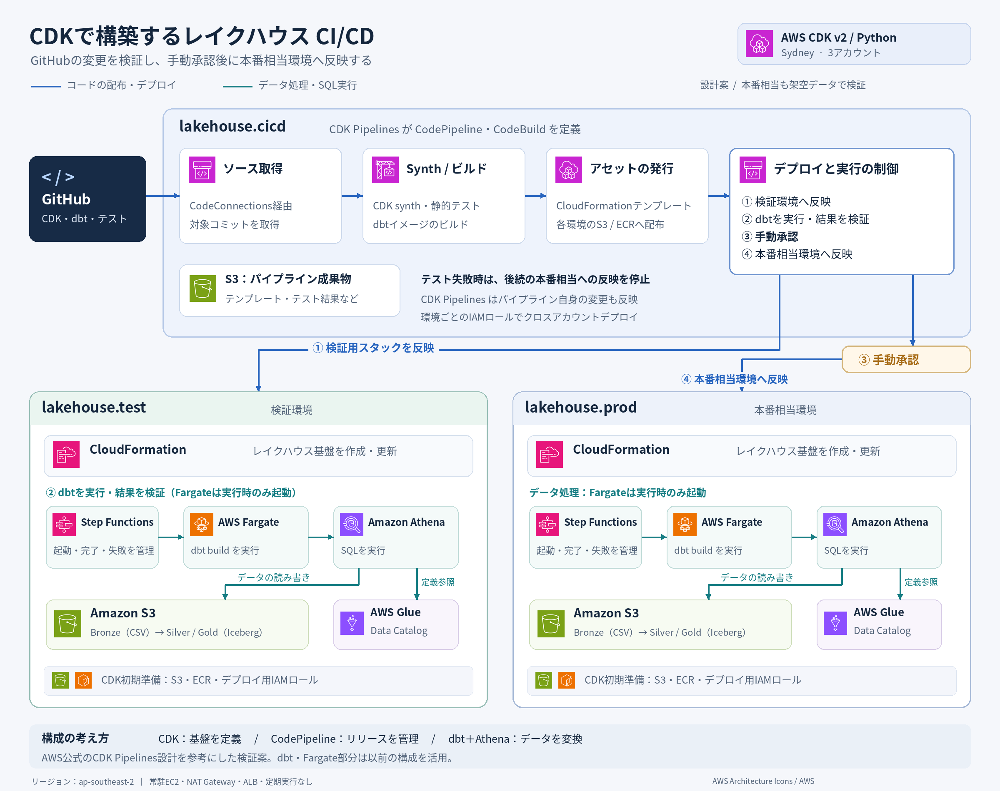

### CDKが定義するもの

CDKのPythonコードを`cdk synth`でCloudFormationテンプレートへ変換し、CloudFormationでリソースを作成します。[以前の検証で使用したCloudFormationテンプレート](https://zenn.dev/kkoch5t2/articles/aws-dbt-athena-medallion-lab)は`CfnInclude`で取り込みました。以前の検証でデプロイしたリソースを操作するのではなく、新しいアカウント内に独立したリソースを作成します。

:::message
**CfnIncludeとは？**

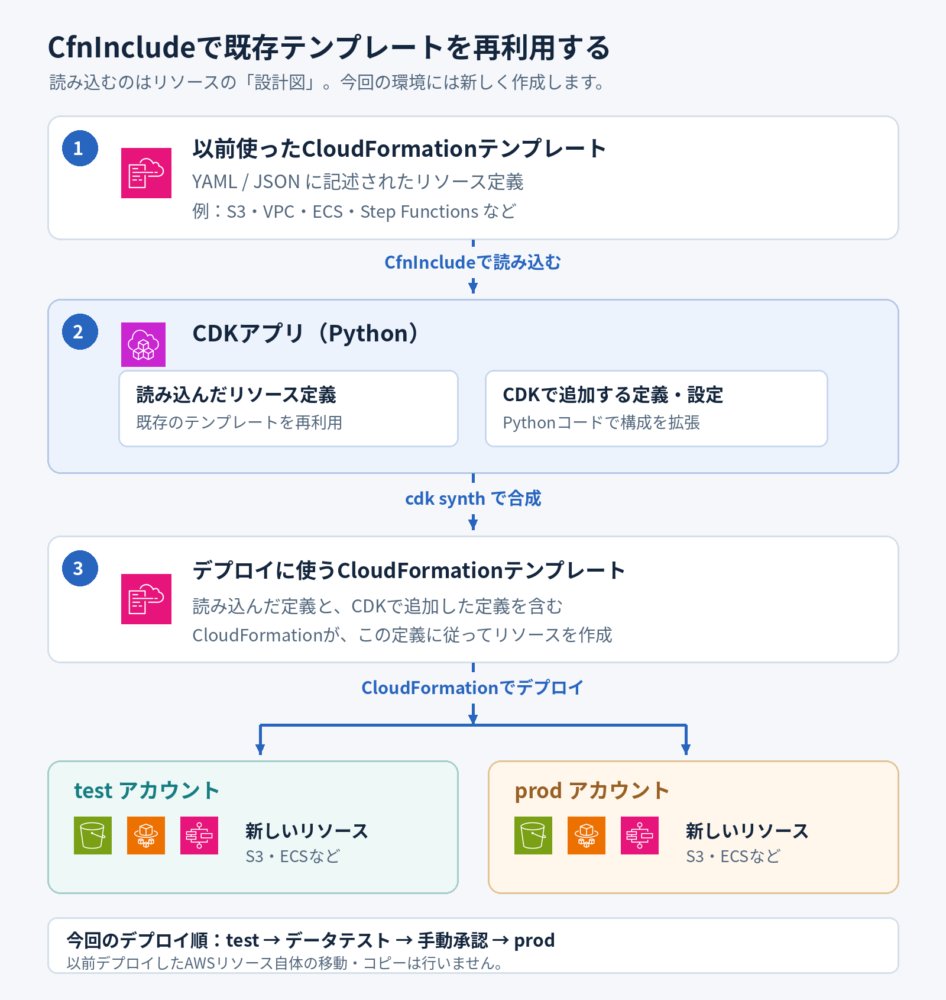

`CfnInclude`は、既存のCloudFormationテンプレート（YAML／JSON）をCDKアプリへ読み込み、テンプレート内のリソース定義をCDKから扱えるようにする機能です。すべての定義をPythonで書き直さずに再利用できます。

`cdk synth`を実行すると、読み込んだ定義を含むCloudFormationテンプレートが生成されます。今回の検証では、この仕組みで以前のレイクハウス構成を再利用し、test・prodアカウントへ新しくデプロイしています。

詳しくは[AWS公式ドキュメント「既存のCloudFormationテンプレートをインポートする」](https://docs.aws.amazon.com/cdk/v2/guide/use-cfn-template.html)を参照してください。
:::

S3バケット、Glueデータベース、Bronzeの外部テーブル、Athena WorkGroup、VPC、ECSタスク定義、Step FunctionsなどがIaCの対象です。Silver・GoldのIcebergテーブルは、デプロイ後にdbtを実行したときに作成します。

### CodePipelineの実行内容

パイプラインは、GitHubのコード取得、構成テスト、CDKの合成、パイプライン自身の更新、コンテナーイメージの発行、testへのデプロイ、データテスト、手動承認、prodへのデプロイ、データテストの順で進みます。

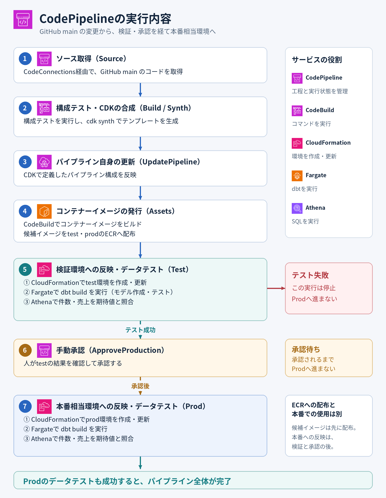

CDK PipelinesはAWS CodePipelineを構成するためのCDKのライブラリです。今回のデータ変換はGlue ETLジョブではなく、[以前の検証と同じdbt・Athena・Fargate](https://zenn.dev/kkoch5t2/articles/aws-dbt-athena-medallion-lab)を使います。[AWS公式のCDK Pipelinesを使ったデータレイクETLの記事](https://aws.amazon.com/blogs/devops/deploying-data-lake-etl-jobs-using-cdk-pipelines/)を参考にしていますが、サンプルをそのまま再現した構成ではありません。

## 🛠️ 初期設定とパイプラインの作成

### 各アカウントのbootstrap

CDKのbootstrapは、テンプレートなどを保存するS3、コンテナーイメージを保存するECR、デプロイ用IAMロールなどを用意する処理です。3アカウントそれぞれで実行し、test・prodではcicdアカウントからのデプロイを信頼する設定にします。

この検証ではCloudFormation実行ロールにAdministratorAccessを使用しています。実運用では、デプロイ対象に合わせて権限を制限する設計が必要です。

以下は、bootstrap完了後の設定を2026年11月22日に再撮影した実画面です。CloudFormationの`CDKToolkit`スタックから確認します。画面は必要な設定部分を抜粋し、AWSアカウントIDを含む物理IDやパラメータ値をマスクしています。

#### cicdアカウントで作成されたリソース

左側の`CDKToolkit`が`CREATE_COMPLETE`となっています。`Resources`タブでは、コンテナーイメージ用の`ContainerAssetsRepository`（ECR）や、デプロイ用の`DeploymentActionRole`などが作成されたことを確認できます。画像はリソース一覧の一部です。

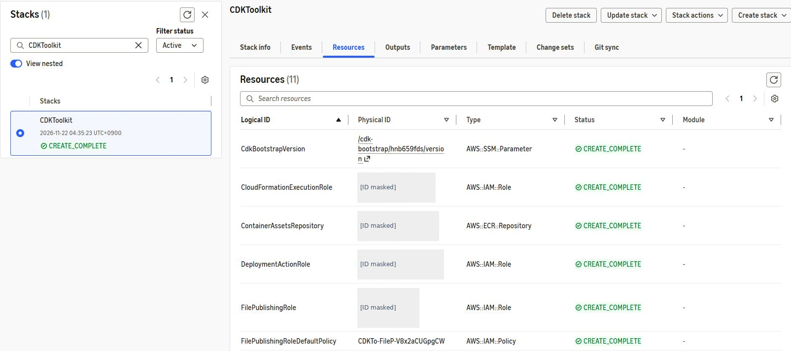

#### testアカウントの信頼先設定

testでも`CDKToolkit`が`CREATE_COMPLETE`となっています。`Parameters`タブの検索欄に`Trusted`を入力し、`TrustedAccounts`にcicdアカウントのIDが設定されていることを確認しました。この設定により、cicdアカウントからデプロイ用ロールを引き受けられるようにします。画像内の値はマスクしています。

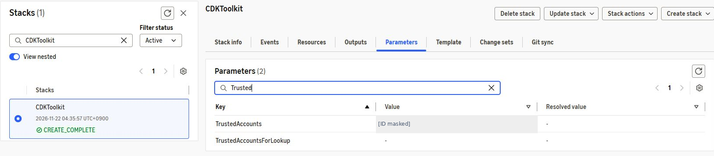

#### prodアカウントの信頼先設定

prodでも同様に、`CDKToolkit`の作成完了と、`TrustedAccounts`に同じcicdアカウントのIDが設定されていることを確認しました。画像内の値はマスクしています。

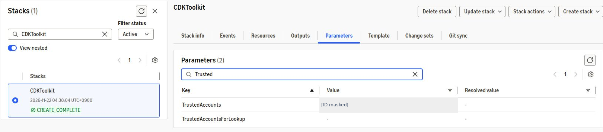

### GitHubとの接続

GitHubとの接続にはAWS CodeConnectionsを使います。CLIで接続を作成した直後はPendingとなり、AWSコンソールでGitHubアプリとの接続を完了するとAvailableになります。GitHub側では新しく作成した検証用リポジトリ1件だけを選択しました。

:::message
**AWS CodeConnectionsとは？**
AWS CodeConnectionsは、CodePipelineなどのAWSサービスと、GitHubなどの外部コードリポジトリを接続するためのサービスです。今回の構成では、GitHubアプリでアクセスを許可したリポジトリからコードを取得し、変更を検知してパイプラインを起動するために使います。

作成した接続には、AWSリソースを識別するARN（Amazon Resource Name）が付与されます。CDKやCodePipelineにはこの接続ARNを指定するため、GitHubのアクセストークンをコードに直接記載する必要はありません。CodeConnectionsがGitHubとの接続を担当し、CodePipelineがコード取得後のビルド・テスト・デプロイの工程を管理します。

詳しくは[AWS公式ドキュメント「接続とは」](https://docs.aws.amazon.com/dtconsole/latest/userguide/welcome-connections.html)を参照してください。
:::

以下の2枚は、接続設定が完了した後に2026年11月22日に再撮影した実画面です。初回の認可操作中の画面ではなく、設定後の内容を確認しています。

まず、Developer ToolsのSettings → Connectionsから接続を開きます。接続名は`lakehouse-cdk-github`、Providerは`GitHub`、Statusは`Available`です。利用するリージョンは`Asia Pacific (Sydney)`となっています。

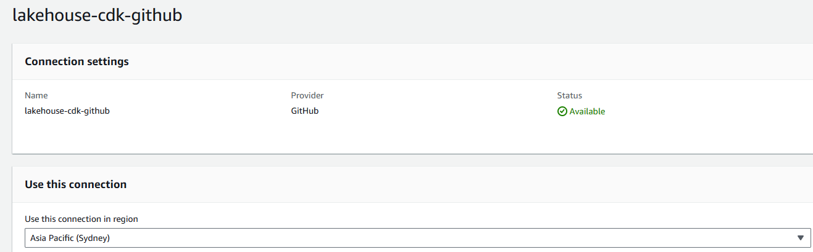

*接続名・Provider・Status・リージョンを抜粋しています。ブラウザ上部と、アカウントIDを含むARN列は切り取っています。*

次に、CodePipelineのSourceアクションを開き、`Input`タブで接続と取得対象を確認します。`ConnectionArn`が使用する接続、`FullRepositoryId`が取得するリポジトリ、`BranchName`がブランチを表します。

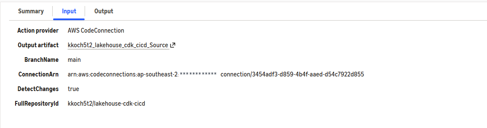

*Sourceアクションの設定部分を抜粋し、ConnectionArn内のAWSアカウントIDをマスクしています。*

| 確認する項目 | 今回の設定 | 意味 |
| --- | --- | --- |
| `ConnectionArn` | 上記のCodeConnections接続のARN | GitHubへの接続に使用する設定 |
| `FullRepositoryId` | `kkoch5t2/lakehouse-cdk-cicd` | コードを取得するリポジトリ |
| `BranchName` | `main` | コードを取得するブランチ |
| `DetectChanges` | `true` | 変更検知を有効にする設定 |

GitHubの本人確認後にAWSへ戻る際、この環境では既定の米国リージョンへ転送されました。今回のプロジェクトに割り当てられたSydneyへ戻り、既存のPending接続でインストール済みアプリを選び直して接続を完了しました。実際に表示されたエラーと対処を、後で再現できるよう記録しています。

### 最初のデプロイと以後の更新

#### 初回は操作端末からパイプライン本体を作成する

パイプラインがまだ存在しない初回は、操作端末からCDKでパイプライン本体をデプロイします。cicdアカウントのCloudFormationに、`LakehousePipeline`スタックが作成されます。

以下は、2026年11月22日にCloudFormationの`Events`タブで作成履歴を確認した実画面です。検索欄に`LakehousePipeline`を入力し、パイプライン本体のイベントを絞り込んでいます。

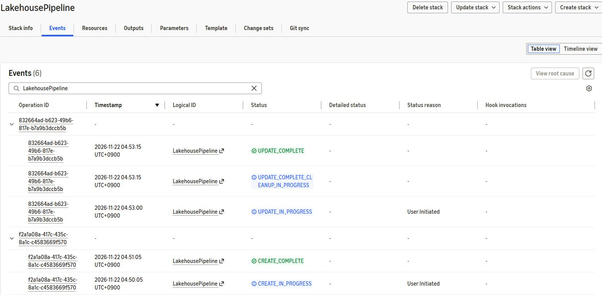

*初回作成時の`CREATE_COMPLETE`と、その後の更新完了を示す`UPDATE_COMPLETE`が記録されています。初回のコマンド実行中の画面ではなく、保存されているイベント履歴を撮影しています。*

パイプライン作成後、この検証では初回の正常系を手動で起動し、test・prodへのデプロイとデータテストまで確認しました。その結果は後述の「検証環境でデータ処理と期待値照合を行う」に掲載しています。

#### 以後はGitHubへのpushで自動実行する

接続設定とパイプラインの作成が完了した後は、GitHubの`main`へのpushでパイプラインが起動します。CodePipelineの`Executions`タブでは、実行に使用したコミットと起動のきっかけを確認できます。

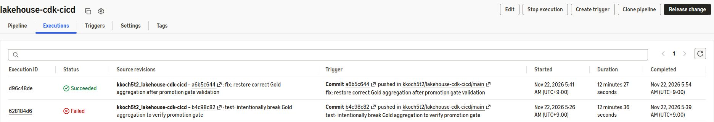

*`Trigger`列の「Commit … pushed in …/main」がpushによる起動を示します。画面は該当する2件を抜粋しています。下の失敗は意図的にGoldの集計SQLを壊した検証、上の成功は修正後の再実行です。詳しい結果は後述します。*

Dockerビルドはパイプライン内のCodeBuildが行うため、手元のPCにDockerを用意する必要はありません。

### 検証に使ったコード

今回使用したCDKアプリ、dbtのモデル・テスト、サンプルCSV、検証用スクリプトは、以下のGitHubリポジトリにまとめています。セットアップと実行の詳しいコマンドはREADMEに記載しています。

https://github.com/kkoch5t2/lakehouse-cdk-cicd

## ✅ 検証環境でデータ処理と期待値照合を行う

### 構成テストとデータテストを実行する場所

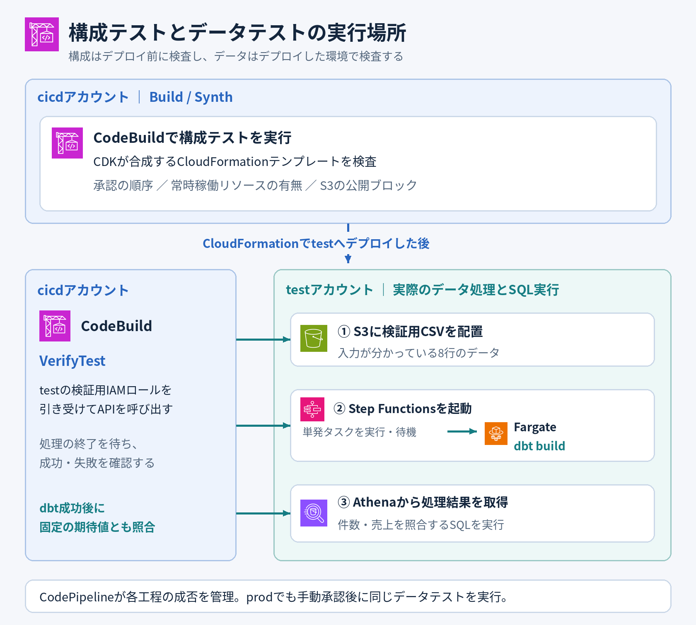

図の下段では、左側が処理を指示するcicdアカウント、右側がデータ処理を行うtestアカウントです。下段の①〜③は、CodeBuildが検証用IAMロールを引き受けて呼び出す処理の順序を示しています。

構成テストは、CDKが合成するテンプレートを調べる処理です。手動承認が本番デプロイより先にあるか、常時稼働のECSサービスやNAT Gatewayを作っていないか、S3の公開ブロックがあるかなどを確認します。

データテストは、実際にtestへデプロイした後で実行します。CodeBuildから検証用IAMロールを引き受け、CSVをS3へ配置し、Step Functionsを起動します。Step FunctionsはFargateの単発タスクで`dbt build`を実行し、コンテナーの終了コードを確認します。

dbtが失敗すればStep Functionsも失敗し、それを待つCodeBuildも失敗します。したがってパイプラインは後続の本番ステージへ進みません。

### dbtテストに加えて固定の期待値を確認する

| 確認対象 | サンプルCSVに対する期待値 |
| --- | --- |
| Bronze | 8行 |
| Silver正常データ | 4行 |
| Silver不正データ | 3行 |
| Gold | 2026-11-01、注文2件、売上3850.00 |

CodeBuildは、dbtの終了後にAthenaで上記の結果を照合します。`dbt build`が終了しただけで成功とせず、既知の入力に対する結果まで確認するためです。

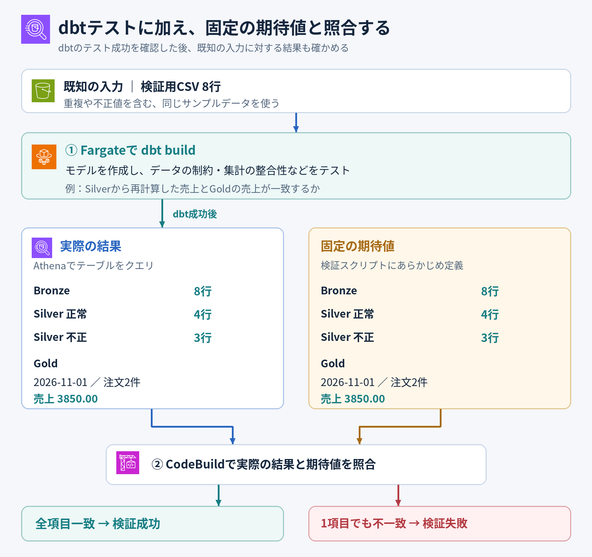

左は正常系で実際に取得した結果、右は検証スクリプトにあらかじめ定義した期待値です。dbt内の整合性テストとは別に、CodeBuildで両者を照合します。

初回実行では、test・prodの両方で表の期待値と一致しました。dbtは両環境とも3モデル・8データテストが成功し、ログは`PASS=11 WARN=0 ERROR=0`となりました。dbt自体の実行時間はtestが約26.02秒、prodが約26.00秒です。コンテナーの起動待ちやCodeBuildの準備は、このdbt実行時間には含みません。

Test成功後に手動承認で止まっている画面です。この検証では結果を確認してから承認操作を行い、Prodへ進めました。

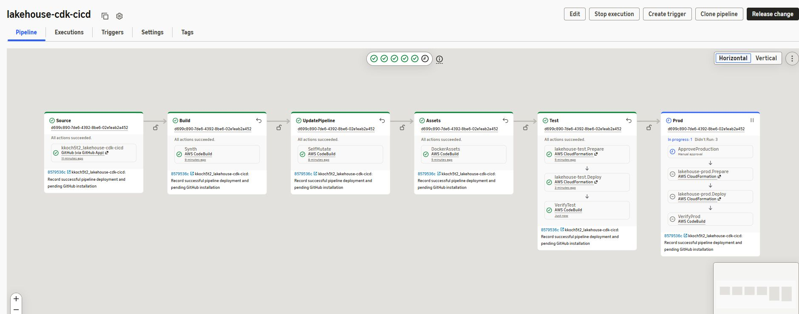

初回は全ステージが成功し、パイプライン全体では16分47秒でした。

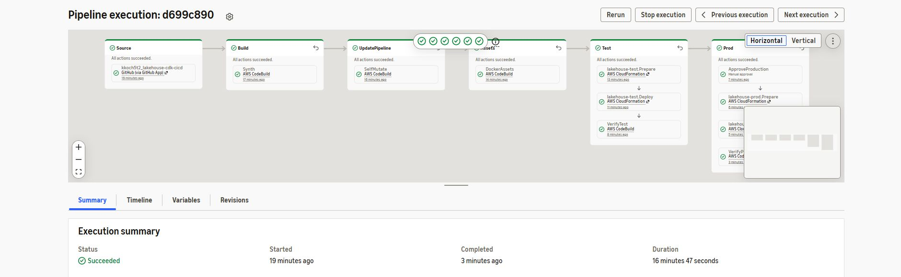

## 🧪 意図的な失敗で本番への昇格を止める

GoldのSQLを`sum(amount)`から`sum(amount) + 100`へ変更します。SQLの構文としては実行できても、Silverから再計算した売上との照合テストが不一致を検出する変更です。

確認するのは、Testの失敗、本番デプロイが実行されないこと、直前に成功した本番のタスク定義とイメージが変化しないことです。CodePipelineの画面では以前の成功結果も残るため、今回の実行IDとアクション履歴を合わせて確認します。

この構成では、Assetsステージで候補イメージをtest・prodのECRへ先に配布します。品質テストが失敗した場合に止める対象は、そのイメージを本番のタスク定義へ反映するデプロイと、本番のデータ処理実行です。本番ECRに候補イメージが存在することと、本番でそのイメージを使うことは区別します。

修正後は元のSQLへ戻してpushし、Test成功、手動承認、Prod成功までを確認します。

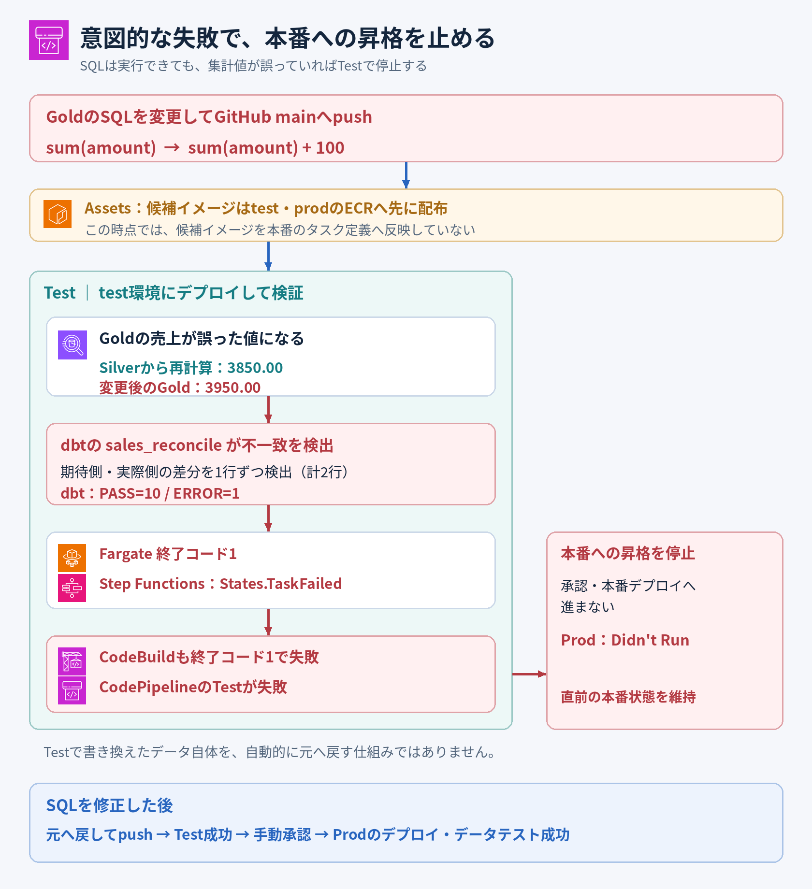

図は今回の故障テストで失敗が伝わった経路です。固定値との照合より前にdbtの`sales_reconcile`が不一致を検出したため、この実行ではその後のCodeBuildによる固定値照合へ進んでいません。本番ECRへの候補イメージの配布と、本番デプロイの停止も分けて示しています。

### 意図的な失敗の結果

故障を入れたコミットはGitHubのWebhookで自動起動しました。CDKの構成テストとインフラのデプロイは成功しましたが、`sales_reconcile`が不一致2行を検出し、dbtは`PASS=10 WARN=0 ERROR=1`となりました。

以下は、故障テスト時に保存した`dbt.log`から、エラーと集計行をWindowsのPowerShellで抜粋表示した実画面です。

**実行したコマンド**

```powershell
Get-Content .\evidence\02-broken-gold\test-dbt\logs\dbt.log |
  Select-String -Pattern '\[error\]|Done\. PASS='
```

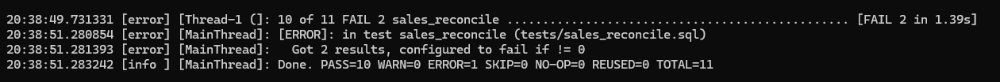

*2026年11月22日の検証ログを、11月23日にNAB7で再表示して撮影しています。故障テストを再実行した画面ではありません。ログ時刻はUTCです。画像は該当する4行を抜粋し、ユーザー名を含むプロンプト部分を切り取っています。*

この照合SQLは、期待側にしかない行と実際側にしかない行を両方向の`EXCEPT`で取り出して結合します。今回の2行は、期待側と実際側の集計行がそれぞれ1行ずつ異なるためです。

実行ログではFargateの終了コードが1となり、`ecs:runTask.sync`のタスクが`States.TaskFailed`で失敗しました。CodeBuildも終了コード1となり、CodePipelineのTestが失敗、Prodは`Didn't Run`となりました。ワークフローには正常終了確認用のChoiceもありますが、今回の失敗はその前のECS連携タスクから伝わっています。

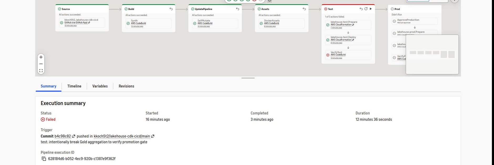

本番については次を検査し、全て一致しました。

| 確認項目 | 故障前後の比較 |
| --- | --- |
| スタック最終更新時刻 | 変化なし |
| タスク定義ARN | 変化なし |
| 使用するイメージURI・ダイジェスト | 変化なし |
| Step Functions実行履歴 | 追加なし |
| 故障テスト実行IDのProdアクション | 0件 |
| Athenaで再確認したGold | 2026-11-01、注文2件、売上3850.00 |

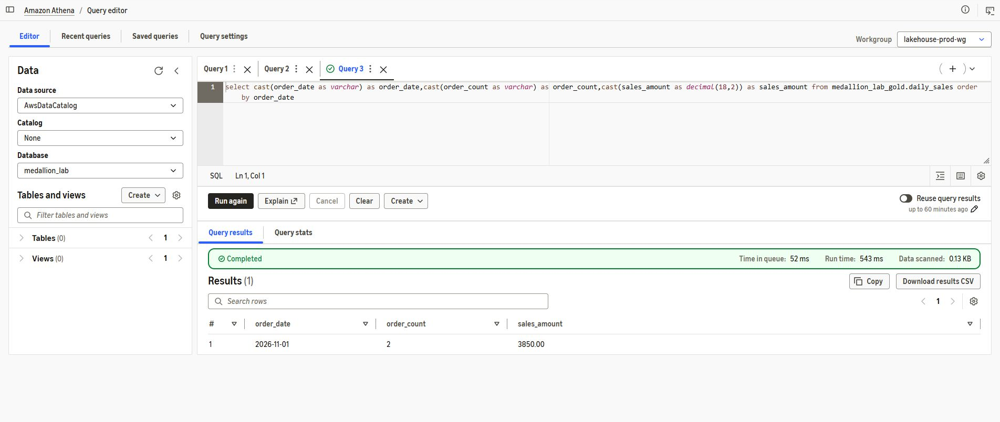

### 修正後の再昇格

`sum(amount)`へ戻したコミットもWebhookで自動起動し、Test成功後に手動承認を経て、Prodのデータテストまで全ステージが成功しました。修正後のdbt実行時間はtestが約38.02秒、prodが約33.08秒でした。パイプライン全体は12分27秒で、両環境の件数・売上の期待値照合も再び成功しました。

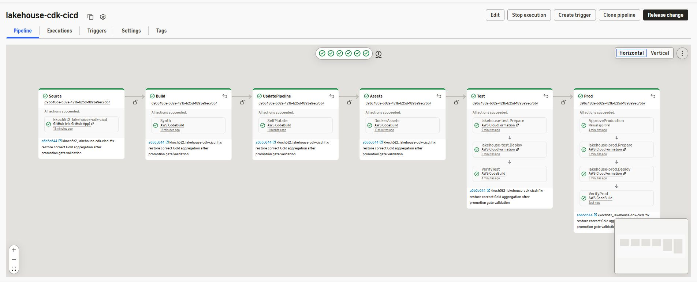

| ケース | コミット | 実行IDの先頭8文字 | 結果 |
| --- | --- | --- | --- |
| 初回正常系 | `8579536c` | `d699c890` | Test・Prod成功 |
| 意図的な故障 | `b4c98c82` | `628184d6` | Test失敗、Prod未実行 |
| SQLを修正 | `a6b5c644` | `d96c48de` | Test・Prod成功 |

接続作成直後のPending状態でもSource失敗が2回記録されています。これらはGitHub接続前の初期設定に伴う失敗で、表のデータ品質テストとは分けて扱っています。

## 📝 検証で学んだことと片付け

### インフラの成功とデータ処理の成功は別に確認する

CDK synthやCloudFormationの成功だけでは、SQLの実行結果まで保証されません。構成テスト、AWSへの実デプロイ、dbtテスト、固定の期待値との照合をそれぞれの場所で実行する構成にしました。

修正後に使用しているイメージのダイジェストはtest・prodで一致し、初回に検証した正しいイメージに戻っていました。

また、データテストが失敗しても、その実行中に書き換えたテーブル全体が自動的に元へ戻るわけではありません。今回止めるのは次の環境への昇格です。全モデルの一括ロールバックや公開前データの切り替えは、別の設計になります。

### 実行コストと残るリソース

Fargateは0.5 vCPU・1 GiBの単発タスクです。ECSサービス、EC2、NAT Gateway、ロードバランサー、定期実行は作成していません。CodeBuild・CodePipeline V2・Fargate・Athenaの実行と、S3・ECR・CloudWatch Logs・KMSなどに課金されます。手動承認の待機中にCodeBuildを動かす構成にはしていません。

CodePipeline V2はアクションごとに実行時間を分単位で切り上げ、1分あたり0.002 USDです。手動承認とカスタムアクションは課金対象外です。CodeBuildの実行料はこれと別にかかります。料金計算では無料枠を控除せず、1 USD = 150円、税別として概算します。

実行ログから集計した、CodeBuildとCodePipelineの主な実行料の概算は次のとおりです。

| 対象 | 集計量 | USD | 円換算 |
| --- | --- | --- | --- |
| CodeBuild small | 約31課金分 | 0.155 | 23.25円 |
| CodePipeline V2 | 61アクション課金分 | 0.122 | 18.30円 |
| 上記2サービスの小計 | — | 0.277 | 41.55円 |

これは請求明細の確定額ではなく、実行時間と料金単価による概算です。Fargate・パブリックIPv4・Athena・S3・ECR・CloudWatch Logs・Step Functions・KMSは小計に含みません。保存期間によっても料金が変わります。無料枠とクレジットは控除していません。

最終確認では両環境ともFargateの実行中タスクは0でした。確認用にS3・ECR・KMSなどは残しており、保存・維持に伴う料金は継続します。

証跡を保存した後に片付けます。データと結果のS3バケットはRetainとしているため、ワークロードスタックを削除しても残ります。CDKToolkitとそのS3・ECRも別に存在します。スタック削除だけで全ての課金対象が消えるとは扱わず、残るリソースを確認します。

### 参考資料

- [CDK Pipelines](https://docs.aws.amazon.com/cdk/v2/guide/cdk-pipeline.html)
- [CloudFormationテンプレートの取り込み](https://docs.aws.amazon.com/cdk/v2/guide/use-cfn-template.html)
- [CDK bootstrap](https://docs.aws.amazon.com/cdk/v2/guide/bootstrapping.html)
- [Deploy data lake ETL jobs using CDK Pipelines](https://aws.amazon.com/blogs/devops/deploying-data-lake-etl-jobs-using-cdk-pipelines/)
- [CodePipeline料金](https://aws.amazon.com/codepipeline/pricing/)
- [CodeBuild料金](https://aws.amazon.com/codebuild/pricing/)
