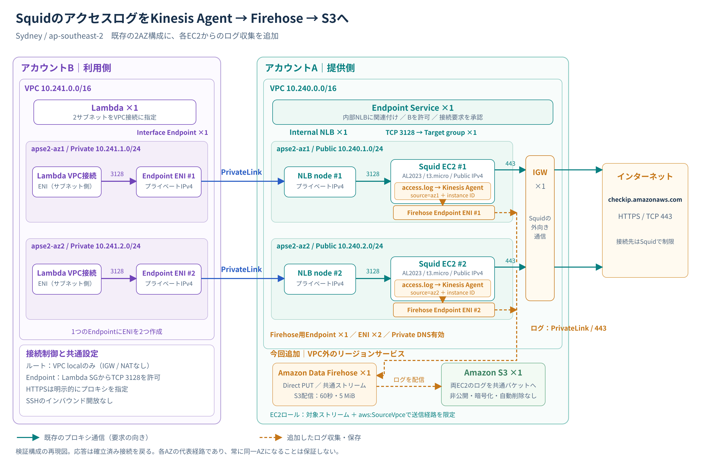
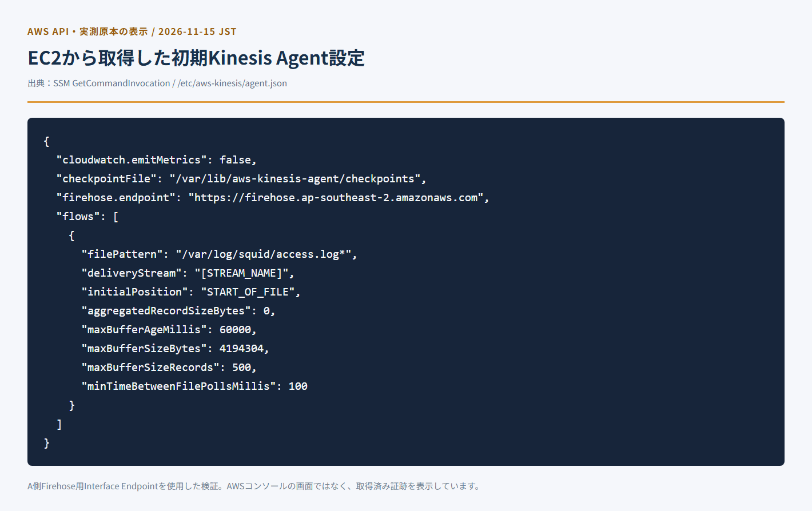
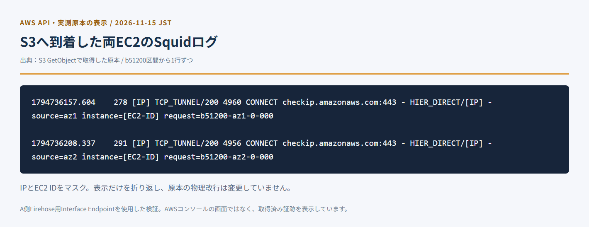
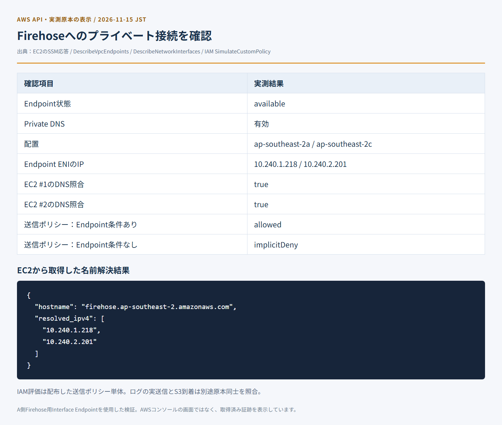
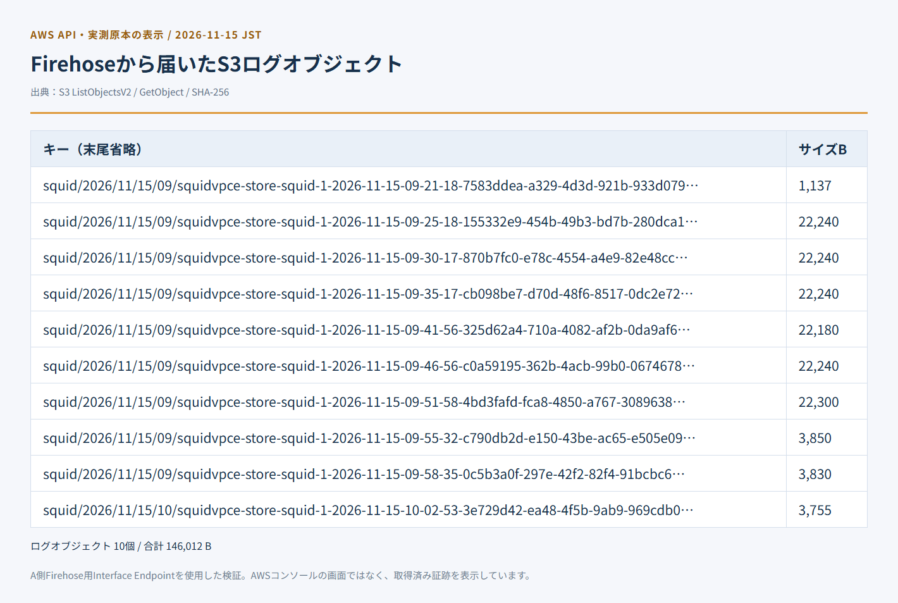
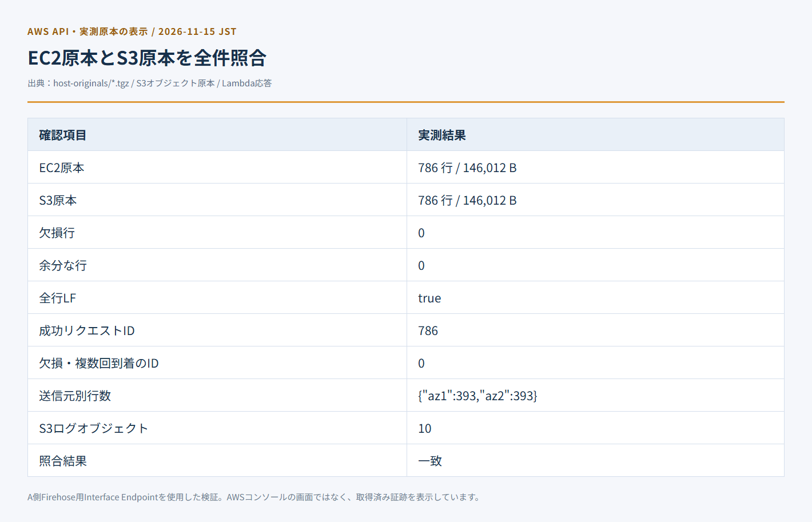
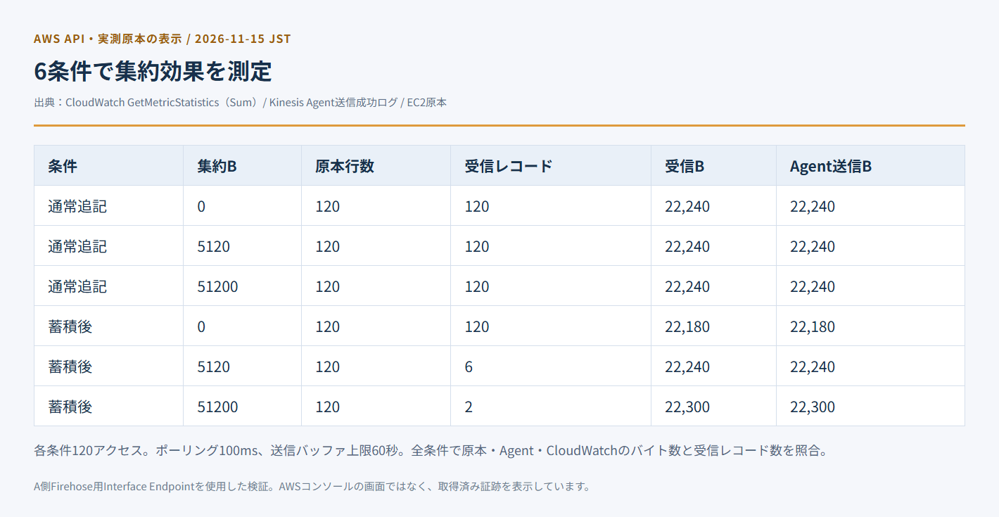
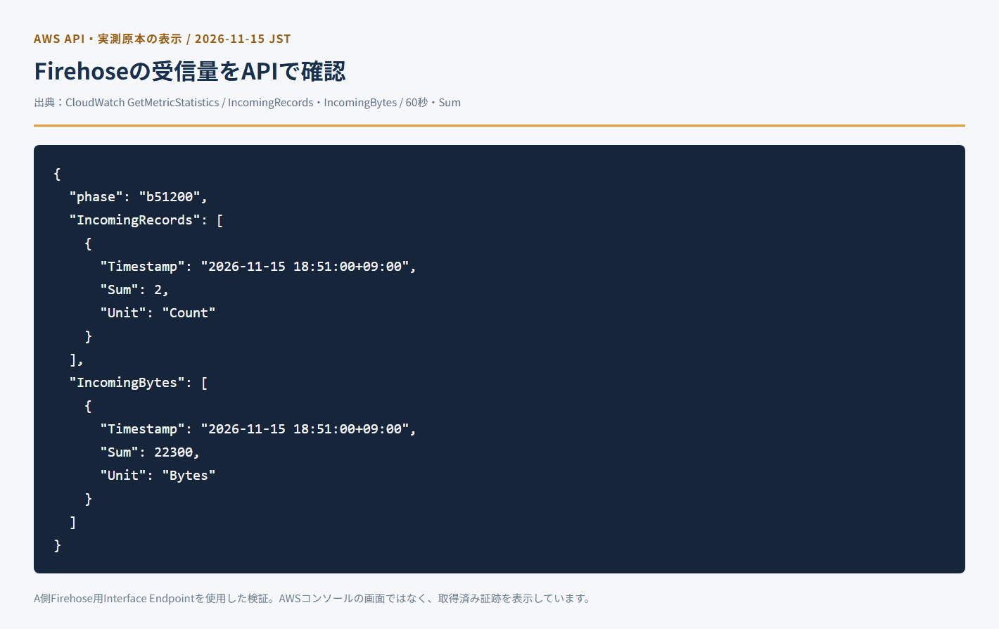
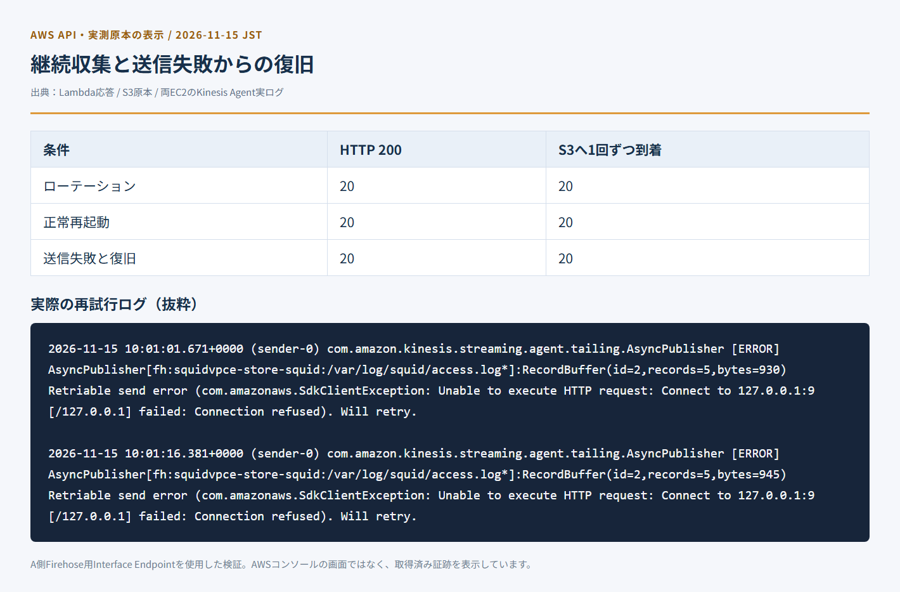

PrivateLink経由で使うSquidプロキシに、アクセスログの収集・保存を追加しました。EC2上のAmazon Kinesis Agentが実際の`access.log`を読み、Firehose用のInterface VPC Endpointを経由してAmazon Data Firehoseへ送り、S3へ保存します。

今回は、Kinesis Agentの`aggregatedRecordSizeBytes`を変えたとき、複数行がどのように送信レコードになるのかも確認します。対象は実際のプロキシ通信で生成されたログです。ログ送信にはPythonによる自作処理を使っていません。

別アカウントからプロキシを使う仕組みと、Firehoseのレコード単位の料金については、次の記事で説明しています。

https://zenn.dev/kkoch5t2/articles/aws-privatelink-squid-proxy

https://zenn.dev/kkoch5t2/articles/firehose-direct-put-cost

## 全体構成と今回追加するリソース

### 通信経路とログ経路

アカウントBのLambdaから、Interface VPC Endpoint、アカウントAの内部NLB、Squidを通じて、`checkip.amazonaws.com`へHTTPS接続します。この通信経路は既存構成と同じです。

追加するのは、各Squid EC2からS3までのログ経路です。A側VPCの2AZにFirehose用Interface VPC EndpointのENIを配置し、2台のKinesis Agentから共通のFirehoseストリームへ送ります。保存先のS3バケットも共通です。


*検証構成の再現図です。既存のプロキシ通信を実線、今回追加したログ経路をオレンジの破線で示しています。SquidとKinesis Agentは同じEC2内で動かします。*

ログ送信は **Kinesis Agent → Firehose用Interface Endpoint → Firehose → S3** です。Kinesis AgentからFirehoseへの通信には、EC2の公開IPv4やInternet Gatewayを使いません。

一方、Squidが外部サイトへ接続する通信には、従来どおり公開IPv4とInternet Gatewayを使います。プロキシの外部接続と、AWSへのログ送信は別の経路です。

| 配置 | リソース・設定 |
|---|---|
| A側EC2 | Amazon Linux 2023、t3.microを2AZに1台ずつ。SquidとKinesis Agentを同居 |
| A側ログ送信 | Firehose用Interface Endpoint 1個・2AZのENI、Private DNS有効、専用セキュリティグループ |
| A側ログ保存 | Direct PUTのFirehose 1本、非公開のS3バケット1個、配信用IAMロール |
| B側 | 外部へのデフォルトルートがないVPC、2AZのInterface Endpoint、テスト用Lambda |
| Kinesis Agentの認証 | EC2インスタンスロール。対象ストリームへの`firehose:PutRecordBatch`を、このFirehose用Endpoint経由に限定 |
| 収集対象 | `/var/log/squid/access.log*`。CONNECT通信を記録し、非圧縮の旧ログも追跡 |

NLBのTCPヘルスチェックもSquidのログに現れたため、比較に混ざらないよう、今回の`access_log`には既存の`CONNECT` ACLを指定しました。Squidが許可する接続は、従来どおり`checkip.amazonaws.com:443`だけです。

### 検証の範囲と費用

リージョンはシドニー（`ap-southeast-2`）です。検証全体の上限を1,000アクセス・Squidログ10MiBとし、100万行の料金検証は行いません。

EC2×2、NLB、B側EndpointとFirehose用Endpointの各2AZ分、公開IPv4×2、8GBのgp3×2を合わせた固定部分は、料金APIで確認した単価では**約$0.116/時、約$2.78/日**です。これに使用NLCU、通信、Firehose、S3、Lambdaなどの従量料金が加わります。無料枠・割引・税は含めていません。

Firehose用Endpointの固定料金は、シドニーでは1AZあたり$0.013/時、2AZで$0.026/時です。これとは別にEndpointのデータ処理料金も発生します。

Kinesis AgentのCloudWatch独自メトリクスは`cloudwatch.emitMetrics: false`で無効にし、比較にはFirehose標準メトリクスを使います。

## CloudFormationでログ収集環境を構築する

### テンプレートの分け方

既存のプロキシ検証用テンプレートは変更せず、リポジトリの`logging/`配下に拡張版を用意しました。

| 順序 | テンプレート | 内容 |
|---|---|---|
| 1 | `00-log-storage.json` | A側のS3、Firehose、配信用IAMロール |
| 2 | `01-provider-logging.json` | A側の2AZプロキシ構成、Firehose用Endpoint、Kinesis Agentの導入・設定・起動 |
| 3 | `02-consumer-logging.json` | B側のVPC、Endpoint、テスト用Lambda |
| 4 | Endpoint接続の承認 | A側でBの接続要求を確認して承認 |

コードと操作手順は、次のリポジトリにまとめています。

https://github.com/kkoch5t2/aws-privatelink-proxy/tree/feat/squid-kinesis-agent-logging/logging

操作例ではA側のAWSプロファイルを`provider`、B側を`consumer`としています。各作成の間に状態を確認し、先行するスタックが完成してから次へ進みます。

```powershell
# A・Bの認証先と既存リソースを確認する
python logging/labctl.py preflight

# A側のログ保存先を作成する
python logging/labctl.py storage

# CREATE_COMPLETEを確認してから次の作成へ進む
python logging/labctl.py status

# A側のプロキシとKinesis Agentを作成する
python logging/labctl.py provider

# A側の完成後、B側の利用環境を作成する
python logging/labctl.py consumer

# B側Endpointの接続要求をA側で承認する
python logging/labctl.py accept
```

### Firehoseへの送信をPrivateLinkに限定する

Firehose用EndpointはA側VPCに作ります。B側からSquidへ接続するためのEndpointとは、配置先も接続先も異なります。

| Endpoint | 配置 | 接続先 | ポート |
|---|---|---|---|
| プロキシ用 | B側VPC・2AZ | A側のEndpoint Service / 内部NLB | TCP 3128 |
| Firehose用 | A側VPC・2AZ | Amazon Data Firehose | TCP 443 |

`01-provider-logging.json`では、次の設定でFirehose用Endpointを作成します。ポリシーも同じテンプレートに定義しています。

```json:01-provider-logging.json（抜粋）
{
  "FirehoseEndpoint": {
    "Type": "AWS::EC2::VPCEndpoint",
    "Properties": {
      "VpcEndpointType": "Interface",
      "VpcId": {
        "Ref": "ProviderVpc"
      },
      "ServiceName": {
        "Fn::Sub": "com.amazonaws.${AWS::Region}.kinesis-firehose"
      },
      "PrivateDnsEnabled": true,
      "SubnetIds": [
        {
          "Ref": "PublicSubnetAz1"
        },
        {
          "Ref": "PublicSubnetAz2"
        }
      ],
      "SecurityGroupIds": [
        {
          "Ref": "FirehoseEndpointSecurityGroup"
        }
      ]
    }
  }
}
```

Private DNSを有効にすると、EC2内で`firehose.ap-southeast-2.amazonaws.com`を名前解決した結果がEndpoint ENIのプライベートIPになります。Kinesis Agentの`firehose.endpoint`は、この通常のサービスURLを使います。URLの文字列だけで公開経路かどうかを判断するのではなく、EC2からの名前解決も確認します。通常のサービス名が返すIPは2AZのENIに対応しますが、常に同一AZのENIを選ぶ設定ではありません。


*今回作成したFirehose用Endpointの実画面です。使用可能（available）、Private DNS有効、2AZのサブネットとENIのプライベートIPを確認しています。一部のリソース識別子をマスクしています。*

アクセス制御は次の3か所に設定しました。

- Endpointのセキュリティグループ：Squid EC2のセキュリティグループからTCP 443だけを許可する。
- Endpointポリシー：EC2インスタンスロールによる、対象ストリームへの`firehose:PutRecordBatch`だけを許可する。
- EC2インスタンスロール：`aws:SourceVpce`条件で、このFirehose用Endpointからの送信だけを許可する。

```json:EC2インスタンスロールの送信権限（抜粋）
{
  "Effect": "Allow",
  "Action": "firehose:PutRecordBatch",
  "Resource": {
    "Fn::Sub": "arn:${AWS::Partition}:firehose:${AWS::Region}:${AWS::AccountId}:deliverystream/${FirehoseStreamName}"
  },
  "Condition": {
    "StringEquals": {"aws:SourceVpce": {"Ref": "FirehoseEndpoint"}}
  }
}
```

このロールのFirehose送信権限はEndpoint経由に限定しています。Private DNSの設定が崩れて公開APIへ向かった場合も、送信権限が成立しない構成です。

### AL2023へのKinesis Agent導入とサービス管理

Amazon Kinesis Agentは、EC2上で常駐するJava製のログ収集サービスです。本構成ではKinesis Data Streamsを挟まず、Firehoseへ直接送信します。

AL2023の公式リポジトリにある`aws-kinesis-agent`を使用します。今回のEC2では`2.0.14-1.amzn2023`、Squidは`6.13-1.amzn2023.0.7`でした。JavaはCorretto 17を指定しています。

```bash
# AL2023のリポジトリからJavaとKinesis Agentを導入する
sudo dnf -y install java-17-amazon-corretto-headless
sudo dnf -y install squid aws-kinesis-agent jq

# ネイティブunitで管理するKinesis Agentの状態を確認する
sudo systemctl status aws-kinesis-agent --no-pager
```

UserDataは`/etc/aws-kinesis/agent.json`とsystemd unitを作り、自動起動を有効にします。Kinesis AgentにはSquidログを読むグループ権限を付け、新しく作られるログも`0640 squid:squid`で読めるようにしました。

チェックポイントは再起動後も残る`/var/lib/aws-kinesis-agent/checkpoints`に置きます。収集位置の記録を消して最初から送り直す方法は使いません。

### Kinesis AgentとFirehoseの設定

```json:agent.json（設定例）
{
  "cloudwatch.emitMetrics": false,
  "checkpointFile": "/var/lib/aws-kinesis-agent/checkpoints",
  "firehose.endpoint": "https://firehose.ap-southeast-2.amazonaws.com",
  "flows": [{
    "filePattern": "/var/log/squid/access.log*",
    "deliveryStream": "YOUR_STREAM_NAME",
    "initialPosition": "START_OF_FILE",
    "aggregatedRecordSizeBytes": 5120,
    "maxBufferAgeMillis": 60000,
    "maxBufferSizeBytes": 4194304,
    "maxBufferSizeRecords": 500,
    "minTimeBetweenFilePollsMillis": 100
  }]
}
```

`initialPosition`は、チェックポイントがないファイルを最初に読む位置です。既存のチェックポイントがある場合の継続位置とは分けて考えます。


*EC2から取得した実際の初期設定を表示した画面。集約は0から比較を開始しています。*

`firehose.endpoint`に指定したURLは、Private DNSによってVPC内のEndpoint ENIへ解決されます。FirehoseからS3への配信はAWSサービス側で行われ、このEC2がS3へ直接ログを送る構成ではありません。

Firehose側はS3向けのバッファを60秒・5MiBとし、圧縮、データ変換、動的パーティショニング、区切り文字の追加は無効にしています。改行はSquidログに含まれるものをそのまま送ります。


*今回のFirehoseのAWSコンソール実画面です。S3配信バッファ60秒・5MiB、圧縮なし、改行の区切り文字追加と動的パーティショニングが無効であることを確認しています。*

## Squid経由で通信してアクセスログを生成する

### 両方のEC2を通ることを確認する

NLBの両ターゲットが`healthy`、B側Endpointが`available`であることを確認してから、LambdaでHTTPS通信を発生させます。今回のテスト用LambdaはEndpointのAZ別DNS名を選択できるため、各AZのSquidを個別に通して確認しました。

```powershell
# AZ1のSquidを通して少量の実通信を行う
python logging/labctl.py generate --route az1 --count 3 --run smoke-az1

# AZ2のSquidを通して同じ通信を行う
python logging/labctl.py generate --route az2 --count 3 --run smoke-az2
```

この管理スクリプトはLambdaの実行と証跡の保存を行います。Firehoseにログを送るのは、EC2上のKinesis Agentです。

### ログに送信元とリクエストIDを残す

Squidのログフォーマットに`source=az1/az2`、EC2のインスタンスID、検証用のリクエストIDを追加しました。


*今回のPrivateLink構成でS3に保存されたログ原本から、AZ1・AZ2の実ログを1行ずつ表示して撮影しました。IPアドレスとEC2 IDをマスクし、読みやすく折り返しています。架空ログや再送データではありません。*

HTTPSのURLパスはCONNECTの中のTLS通信に含まれ、Squidには見えません。検証用IDはCONNECT時の`X-Lab-Request`ヘッダーに入れ、Squidの`%{X-Lab-Request}>h`で記録しています。

最初の少量疎通では、各AZで3アクセスずつ、計6アクセスがすべてHTTP 200で成功しました。EC2原本とS3原本はともに6行・1,137 Bで一致し、欠損・余分な行は0でした。集約比較は、この疎通確認と計測区間を分けて行います。

## PrivateLink経由の送信とS3保存を確認する

### Firehoseへのプライベート接続を確認する

EC2内でサービス名を名前解決し、Firehose用EndpointのENIに割り当てられたプライベートIPと一致することを確認します。

```bash
# EC2内でFirehoseの名前解決先を確認する
getent ahostsv4 firehose.ap-southeast-2.amazonaws.com
```

今回の両EC2では、名前解決先が2AZのEndpoint ENIのIPと一致しました。Endpointは`available`、Private DNSは有効です。

さらに、配布したEC2ロールの送信ポリシーをIAMポリシーシミュレーターで評価し、`aws:SourceVpce`に今回のEndpointを指定すると許可、条件がない場合は`implicitDeny`となることを確認しました。実際の収集では、Kinesis Agentの送信成功記録とS3に保存されたログも合わせて確認します。


*Endpoint・ENIのAWS API応答、EC2から取得した名前解決結果、配布した送信ポリシーの評価結果を表示した画面です。IAMの評価は送信ポリシー単体の確認で、実ログのS3到着は後述の照合で確認しています。*

### S3オブジェクトと入力レコードは別の単位

S3には、Firehoseの配信バッファに応じて作られたオブジェクトが保存されます。**S3ファイルが1個になったことだけでは、Kinesis Agentが1レコードに集約したとは判断できません。** 複数のFirehose入力レコードも、同じS3ファイルに入ります。


*今回のS3から取得したログオブジェクトのキーとサイズを表示した画面です。オブジェクト数と、Firehoseの入力レコード数は異なります。*

### 原本同士を照合する

EC2の現行ログとローテーション済みログ、S3に届いたオブジェクトをそれぞれ原本のまま保存します。改行を含む行の内容と出現回数を比較し、同一行の重複も確認します。

```powershell
# S3オブジェクト、EC2ログ、設定、Kinesis Agentログを原本として保存する
python logging/labctl.py collect --run final

# 改行を含む行単位の一致と、成功したリクエストIDの到着を確認する
python logging/verify_logs.py --snapshot final
```

| 確認項目 | 最終結果 |
|---|---:|
| EC2原本 / S3原本 | どちらも786行・146,012 B |
| S3のログオブジェクト | 10個 |
| 欠損行 / 余分な行 | 0行 / 0行 |
| 成功した通信のID | 786件すべてが1回ずつ到着 |
| 改行 | 全行LFを保持 |
| 送信元 | AZ1・AZ2とも393行 |


*今回のPrivateLink構成から取得したEC2・S3ログ原本を照合した結果です。786行・146,012 Bの一致、欠損・余分な行0、成功ID786件を確認しました。*

ログの全体順序は、複数EC2から共通ストリームへ送る構成では判定基準にしていません。送信元の識別と、行の内容・回数・改行を照合しています。

## Kinesis Agentによる集約効果を確認する

### 待機時間・APIバッチ・行の集約を区別する

| 設定・動作 | 役割 |
|---|---|
| `aggregatedRecordSizeBytes` | パーサーが読んだ完全な行を、指定バイト数を目安に1レコードへ連結する |
| `maxBufferAgeMillis` | 作成済みのレコードを、送信バッファに保持する時間の上限 |
| `PutRecordBatch` | 複数の入力レコードを1回のAPIリクエストに載せる |
| Firehoseの60秒・5MiB | 受信後、S3へ配信する側のバッファ設定 |

`aggregatedRecordSizeBytes`は、指定サイズに達するまで後続の行を待つタイマーではありません。読み込んだ範囲に完全な行が1行しかなければ、サイズを大きくしても、その1行でレコードができる場合があります。

このため、送信待機を60秒にしても「60秒分が必ず1レコードになる」とは限りません。設定値を目標サイズと読み替えず、実際の`IncomingRecords`を確認します。

### 通常の追記と、蓄積したログの読み込みを比較する

各方式は、各AZのEC2へ順に60アクセスずつ、合計120アクセスでそろえました。ファイルのポーリングは100ms、送信バッファの時間上限は60秒のままにしています。

「通常の追記」ではKinesis Agentを動かしながらログを発生させます。「蓄積後」ではKinesis Agentを正常停止した状態で同じ件数のログを発生させ、開始後に読み込ませます。この2つは別の条件として比較します。

| 読み込み条件 | 集約サイズ | アクセス数 | IncomingRecords | IncomingBytes | 平均B/レコード |
|---|---:|---:|---:|---:|---:|
| 通常の追記 | 0 B | 120 | 120 | 22,240 B | 185.3 B |
| 通常の追記 | 5,120 B | 120 | 120 | 22,240 B | 185.3 B |
| 通常の追記 | 51,200 B | 120 | 120 | 22,240 B | 185.3 B |
| 蓄積後に開始 | 0 B | 120 | 120 | 22,180 B | 184.8 B |
| 蓄積後に開始 | 5,120 B | 120 | 6 | 22,240 B | 3,706.7 B |
| 蓄積後に開始 | 51,200 B | 120 | 2 | 22,300 B | 11,150.0 B |


*Firehose用Endpointを使った今回の6条件の測定結果です。CloudWatch APIのSum、Kinesis Agentの送信成功記録、EC2原本を並べて照合しています。*

通常の追記では、集約サイズを5,120 B、51,200 Bにしても120レコードのままでした。今回の追記間隔と100msのポーリングでは、読み込む範囲に1行ずつ現れるためです。送信バッファに60秒保持する動作が、その後の行との再集約を行うわけではありません。

一方、停止中に蓄積したログを読む条件では、5,120 Bで6レコード、51,200 Bで2レコードになりました。51,200 B設定でも実際の平均は11,150.0 Bです。指定値まで埋まることを保証する設定ではありません。

Squidログの内容は可変なので、同じアクセス数・条件でも入力バイト数は一定ではありません。表では実際のバイト数も並べています。蓄積後の結果を、そのまま低頻度のリアルタイム収集の削減率として扱うことはできません。


*蓄積後の51,200 B設定について、CloudWatch APIで取得したIncomingRecords・IncomingBytesの時刻、Sum、単位を表示しています。*

各計測区間の`IncomingBytes`と`IncomingRecords`はSumで取得し、Kinesis Agentが成功応答を記録したレコード数・バイト数、EC2/S3の原本と照合しました。前方式の未送信レコードが次の方式に混ざらないよう、区間を分けています。

### 料金は入力レコードごとの切り上げで計算する

Direct PUTの計算上の課金対象量は、**各入力レコードを5,120 B単位で切り上げて合計**します。`IncomingBytes`の総量を最後に1回だけ切り上げる計算ではありません。

| 条件 | 入力レコード数 | 計算上の課金対象量 | 同条件の集約なし比 |
|---|---:|---:|---:|
| 通常の追記：3設定とも | 120 | 614,400 B | 削減なし |
| 蓄積後：集約なし | 120 | 614,400 B | 基準 |
| 蓄積後：5,120 B | 6 | 30,720 B | 95.0%削減 |
| 蓄積後：51,200 B | 2 | 30,720 B | 95.0%削減 |

51,200 B設定では、Kinesis Agentの成功記録で**11,150 Bのレコードを2つ**確認しました。各レコードを5,120 B単位で切り上げ、15,360＋15,360＝30,720 Bと計算します。総受信量を最後に1回だけ切り上げる計算は使いません。

5,120 B設定の6レコードは、それぞれ5,120 Bの課金対象となります。今回は、51,200 Bへ変更するとレコード数はさらに減りましたが、切り上げ後の課金対象量は変わりませんでした。

これらは今回の実測に基づく課金対象量の計算です。Cost Explorerでこの検証分だけの料金を測定した数値ではありません。また、前回のPython検証の削減率をKinesis Agentの結果として流用していません。

## ローテーション・再起動・送信失敗への対応

### ログローテーション後も収集を継続する

今回は`copytruncate`ではなく、ファイルのrename、新しいファイルの作成、Squidによる再オープンを使います。Kinesis Agentは`access.log*`を監視するため、旧ファイルも非圧縮のまま残します。

```bash
# ローテーションを実行し、旧ログと新しいログの権限を確認する
sudo logrotate -f /etc/logrotate.d/squid
sudo ls -l /var/log/squid/access.log*
```

`logfile_rotate 0`でSquid自身による二重の連番ローテーションを避け、`create 0640 squid squid`で新ファイルの権限をそろえます。

各EC2でローテーション前後に5アクセスずつ、合計20件を発生させました。旧ファイルと新ファイルの両方を原本として保存し、全20件がS3へ1回ずつ到着することを確認しました。

### Kinesis Agentを再起動する

```bash
# チェックポイントを保持したままKinesis Agentを正常に再起動する
sudo systemctl restart aws-kinesis-agent

# 再起動後の状態と進捗ログを確認する
sudo systemctl status aws-kinesis-agent --no-pager
sudo tail -n 30 /var/log/aws-kinesis-agent/aws-kinesis-agent.log
```

各EC2で正常再起動の前後に5アクセスずつ、合計20件を発生させました。チェックポイントを保持した状態で、全20件が欠損・重複なくS3へ到着しました。確認したのはKinesis Agentプロセスの正常再起動です。

### 送信できない間のログを確認する

接続拒否を模擬するため、Kinesis Agentの送信先を一時的に`https://127.0.0.1:9`へ切り替えました。Squidの通信先やB側のネットワーク設定は変えていません。

両EC2で`Connection refused`と`Retriable send error ... Will retry`を確認しました。送信できない間に生成した10件と、元の設定へ戻してKinesis Agentを再起動した後の10件は、全20件がS3へ1回ずつ到着しています。復旧時にもチェックポイントは削除していません。


*保存済みの送信記録とS3原本を照合し、各20件が1回ずつ到着したことを確認した画面です。下部は今回の送信失敗テストで両EC2に残った実エラーログの抜粋です。保存済み証跡を表示して撮影しており、障害を再発生させた画像ではありません。*

今回の結果だけで、異常終了や応答喪失を含むすべての条件で重複が発生しないとは説明できません。収集位置の記録、送信の再試行、S3到着データを合わせて確認し、必要なら下流でリクエストIDなどによる重複排除を設計します。


**参考資料**

- [AWS：FirehoseとAWS PrivateLink](https://docs.aws.amazon.com/firehose/latest/dev/vpc.html)
- [AWS：Interface EndpointのPrivate DNS](https://docs.aws.amazon.com/vpc/latest/privatelink/interface-endpoints.html)
- [AWS：PrivateLinkの料金](https://aws.amazon.com/privatelink/pricing/)
- [AWS：IAMのグローバル条件キー（aws:SourceVpce）](https://docs.aws.amazon.com/IAM/latest/UserGuide/reference_policies_condition-keys.html#condition-keys-sourcevpce)

- [AWS：Kinesis Agentの設定](https://docs.aws.amazon.com/firehose/latest/dev/agent-config-settings.html)
- [AWS：Kinesis Agentの導入](https://docs.aws.amazon.com/firehose/latest/dev/download-install.html)
- [AWS：Firehoseの料金](https://aws.amazon.com/firehose/pricing/)
- [Amazon Kinesis Agentの公開集約実装](https://github.com/awslabs/amazon-kinesis-agent/blob/aa0d9089ed6b0ce9c10871f403bfcf20b74a461f/src/com/amazon/kinesis/streaming/agent/tailing/AggregationSplitter.java)
