PrivateLink経由で使うSquidプロキシに、Kinesis Agent → Amazon Data Firehose → S3のログ収集を追加しました。実際のアクセスログを送り、到着した内容と、複数行をまとめて送る効果を確認します。

既存のプロキシ構成とDirect PUTの料金の仕組みは、次の記事で説明しています。

https://zenn.dev/kkoch5t2/articles/aws-privatelink-squid-proxy

https://zenn.dev/kkoch5t2/articles/firehose-direct-put-cost

## 全体構成


*上段がプロキシ通信、下段が追加したログ収集です。上下のEC2は同じ2台で、SquidとKinesis Agentを同居させています。*

| 経路 | 通信の流れ |
|---|---|
| プロキシ通信 | B側Lambda → B側Endpoint → A側内部NLB → Squid → 外部サイト |
| ログ送信 | A側Kinesis Agent → Firehose用Endpoint → Firehose → S3 |

追加するFirehose用Endpointは**A側VPC**に配置します。ログ送信はプライベートIPで行い、Squidの外部接続は従来どおり公開IPv4とInternet Gatewayを使います。

シドニー（`ap-southeast-2`）の2AZに、Amazon Linux 2023・t3.microを1台ずつ配置しました。FirehoseとS3は2台で共用します。テスト対象は`checkip.amazonaws.com:443`への実通信です。

:::message
検証日は2026年11月15日です。画像は削除前の設定画面、検証履歴、保存した応答の読み出しを撮影したものです。証跡を取得したコマンドは折りたたみに掲載し、EC2内の操作と区別しています。
:::

## CloudFormationで構築する

### テンプレートと構築手順

`logging/`配下の3ファイルで、ログ保存先・A側・B側の順に作成します。

| 順序 | テンプレート | 作成するもの |
|---|---|---|
| 1 | `00-log-storage.json` | S3、Firehose、配信用IAMロール |
| 2 | `01-provider-logging.json` | 2AZのSquid、Firehose用Endpoint、Kinesis Agent |
| 3 | `02-consumer-logging.json` | B側VPC、プロキシ用Endpoint、テスト用Lambda |

https://github.com/kkoch5t2/aws-privatelink-proxy/tree/feat/squid-kinesis-agent-logging/logging

A側のプロファイルを`provider`、B側を`consumer`として実行します。各スタックの`CREATE_COMPLETE`を確認してから、次へ進みます。

```powershell
# 認証先・既存リソースを確認する
python logging/labctl.py preflight
# ログ保存先、A側、B側の順で作成する。各作成後にstatusで完了を確認する
python logging/labctl.py storage
python logging/labctl.py status
python logging/labctl.py provider
python logging/labctl.py status
python logging/labctl.py consumer
python logging/labctl.py status
# A側でB側Endpointの接続を承認する
python logging/labctl.py accept
```

:::details 証跡の取得コマンドで使う変数
以降のPowerShellは、撮影時に使った`medallion-lab`プロファイルを示します。再現する場合は、自分のプロファイルとリソースIDに置き換えてください。`$ssm`は構築直後の確認コマンドの履歴です。

```powershell
$awsA=@('--profile','medallion-lab','--region','ap-southeast-2','--no-cli-pager')
$ssm=@('--profile','medallion-lab','--region','ap-southeast-2','--command-id','YOUR_INITIAL_INSPECTION_COMMAND_ID','--no-cli-pager')
$az1='YOUR_AZ1_INSTANCE_ID'
$az2='YOUR_AZ2_INSTANCE_ID'
$endpointId='YOUR_FIREHOSE_ENDPOINT_ID'
$endpointSg='YOUR_FIREHOSE_ENDPOINT_SECURITY_GROUP_ID'
$agentRole='YOUR_EC2_ROLE_NAME'
$agentPolicy='YOUR_EC2_INLINE_POLICY_NAME'
$stream='YOUR_FIREHOSE_STREAM_NAME'
$bucket='YOUR_BUCKET_NAME'
```
:::

### Firehoseへの送信をPrivateLinkに限定する

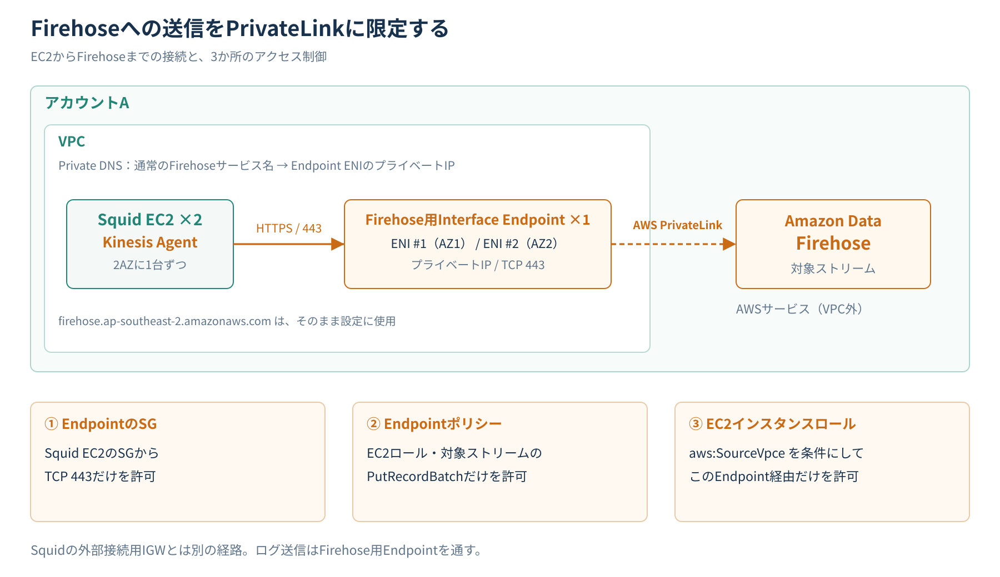
*Firehoseの通常のサービス名をPrivate DNSでEndpointのプライベートIPへ解決し、3か所で送信を制御します。*

| 制御する場所 | 設定 |
|---|---|
| EndpointのSG | Squid EC2のSGからTCP 443のみ許可 |
| Endpointポリシー | EC2ロールから対象ストリームへの`firehose:PutRecordBatch`のみ許可 |
| EC2ロール | `aws:SourceVpce`で今回のEndpoint経由に限定 |

Private DNSを有効にすると、`firehose.ap-southeast-2.amazonaws.com`がEndpoint ENIのプライベートIPを返します。Kinesis Agentには通常のFirehose URLを指定します。2AZのENIが名前解決の対象ですが、同じAZのENIを必ず選ぶ設定ではありません。

:::message
**Private DNS（プライベートDNS）とは？**

DNSは、サービスの名前から接続先のIPアドレスを調べる仕組みです。今回のPrivate DNS設定は、**Firehoseの標準の接続先名（`firehose.ap-southeast-2.amazonaws.com`）を、VPC内の接続先へ結び付ける設定**です。Kinesis AgentのURLを変更せず、Endpoint ENIのプライベートIPへ接続できます。
:::

:::message
**Endpoint ENI（エンドポイント用のENI）とは？**

ENI（Elastic Network Interface）は、AWS上の仮想的なネットワーク接続口です。Interface VPC Endpointを作ると、指定したサブネットごとにAWSがEndpoint専用のENIを作成し、プライベートIPを割り当てます。今回の構成では、**Firehoseへアクセスするための「VPC内の窓口」が、2AZに1つずつ、合計2つある**と考えると分かりやすいです。
:::

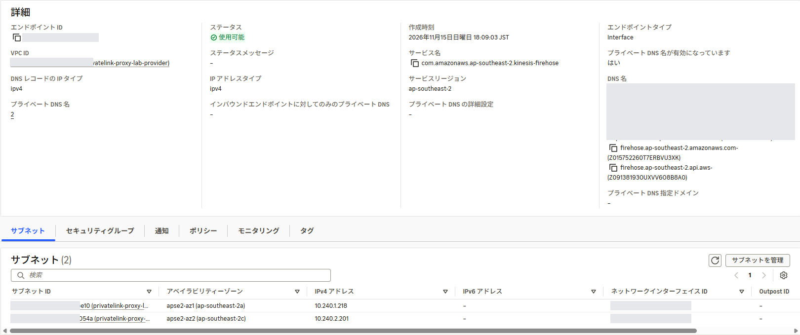
*AWSコンソールでavailable・Private DNS有効・2AZのサブネットを確認しました。一部の識別子をマスクしています。*

:::details SG・Endpointポリシー・EC2ロールの実設定
**実行したコマンド（Windows / PowerShell）**

```powershell
aws ec2 describe-vpc-endpoints @awsA --vpc-endpoint-ids $endpointId --query 'VpcEndpoints[].{Type:VpcEndpointType,Service:ServiceName,PrivateDNS:PrivateDnsEnabled,State:State,SubnetCount:length(SubnetIds)}' --output table
aws ec2 describe-security-groups @awsA --group-ids $endpointSg --query 'SecurityGroups[].IpPermissions[].{Protocol:IpProtocol,FromPort:FromPort,ToPort:ToPort,SourceSG:UserIdGroupPairs[].GroupId,CIDRs:IpRanges[].CidrIp}' --output json
```

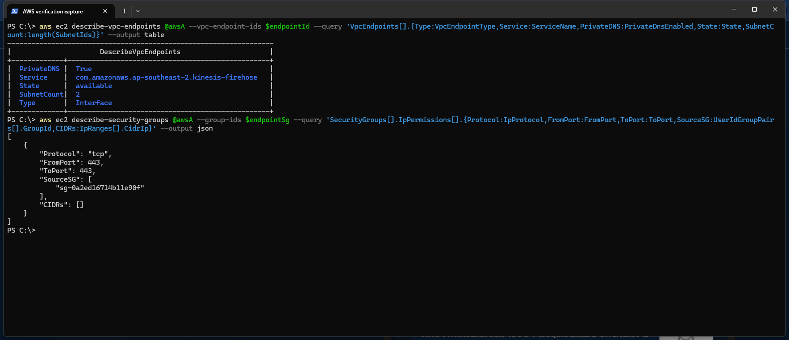
*上段がInterface・PrivateDNS=True・2サブネット。下段はTCP 443をSquid EC2のSGから許可する設定で、CIDRsは空です。*


**実行したコマンド（Windows / PowerShell）**

```powershell
aws ec2 describe-vpc-endpoints @awsA --vpc-endpoint-ids $endpointId --query 'VpcEndpoints[0].PolicyDocument' --output text | ForEach-Object { $_ -replace '\b\d{12}\b','[ACCOUNT]' } | ConvertFrom-Json | ConvertTo-Json -Depth 12
```

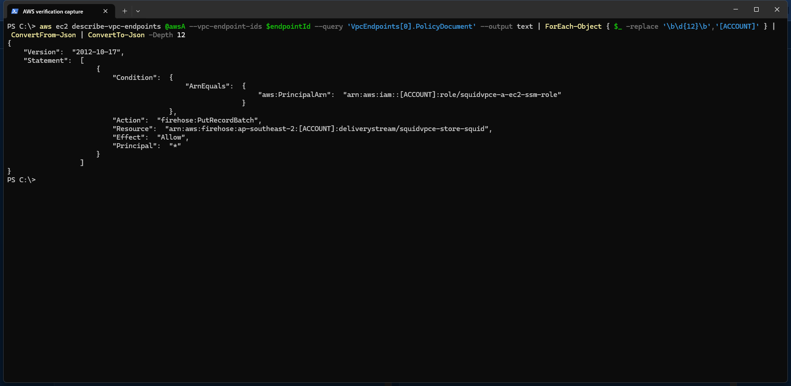
*対象ストリームのPutRecordBatchを許可し、aws:PrincipalArnでEC2ロールに限定しています。アカウントIDは表示時にマスクしています。*


**実行したコマンド（Windows / PowerShell）**

```powershell
aws iam get-role-policy @awsA --role-name $agentRole --policy-name $agentPolicy --query PolicyDocument --output json | ForEach-Object { $_ -replace '\b\d{12}\b','[ACCOUNT]' }
```

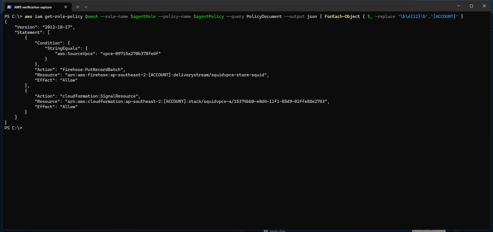
*EC2ロールのPutRecordBatch権限にaws:SourceVpce条件を指定しています。アカウントIDは表示時にマスクしています。*
:::

### Amazon Linux 2023へのKinesis Agent導入とサービス管理

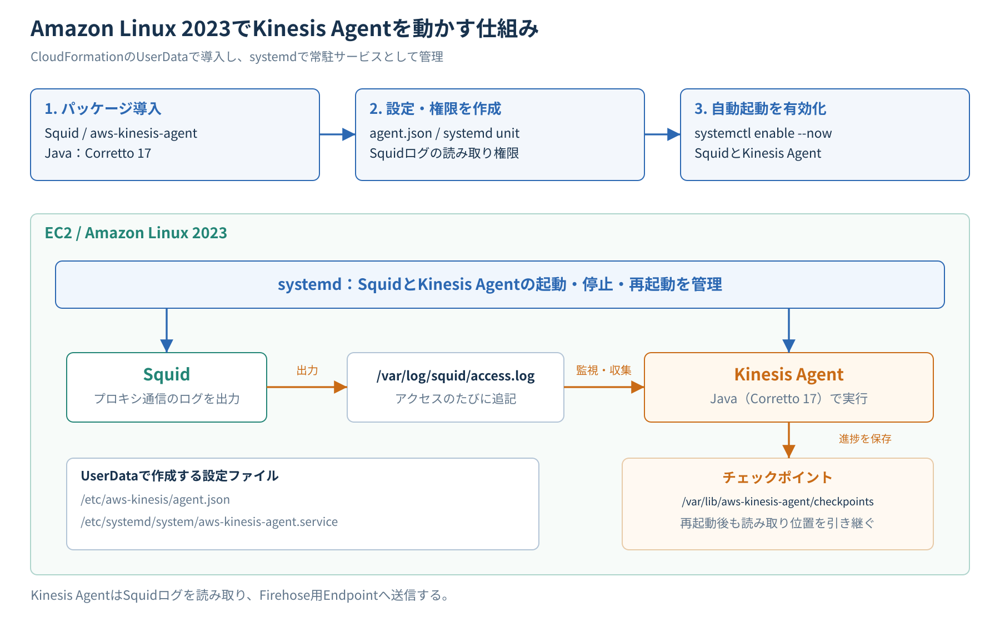
*UserDataでパッケージ・設定・権限を用意し、systemdで起動します。読み取り位置はチェックポイントに保存します。*

Kinesis AgentはEC2上で動くJava製の収集サービスです。Amazon Linux 2023の`aws-kinesis-agent`（今回の環境は`2.0.14-1.amzn2023`）とCorretto 17を使い、Kinesis Data Streamsを挟まずFirehoseへ送信します。

:::message
**Corretto 17とは？**

Amazon Correttoは、Amazonが無償で提供するJavaの開発・実行環境（OpenJDK）です。「17」は対応するJavaのバージョンを表し、長期サポート（LTS）の対象です。今回は、**Javaで作られたKinesis AgentをEC2上で動かすための実行環境**として使っています。
:::

導入はUserDataで自動化しています。AgentにSquidログの読み取り権限を付け、チェックポイントを`/var/lib/aws-kinesis-agent/checkpoints`へ永続化します。

:::details 起動状態・systemd unit・読み取り権限の確認
EC2内で行った主な確認です。

```bash
systemctl is-active squid aws-kinesis-agent
systemctl is-enabled squid aws-kinesis-agent
sudo cat /etc/systemd/system/aws-kinesis-agent.service
sudo ls -l /var/log/squid /var/lib/aws-kinesis-agent
```

次の画面は、これらを含む検証時のSSM実行履歴をWindowsから取得したものです。


**実行したコマンド（Windows / PowerShell）**

```powershell
aws ssm get-command-invocation @ssm --instance-id $az1 --query "[Status,ExecutionStartDateTime]" --output text
aws ssm get-command-invocation @ssm --instance-id $az1 --query StandardOutputContent --output text | Select-Object -First 12
aws ssm get-command-invocation @ssm --instance-id $az2 --query "[Status,ExecutionStartDateTime]" --output text
aws ssm get-command-invocation @ssm --instance-id $az2 --query StandardOutputContent --output text | Select-Object -First 12
```

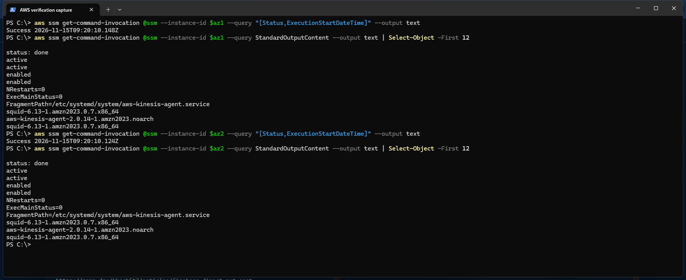
*SSM履歴の先頭12行を表示しています。activeは稼働、enabledは自動起動です。撮影時の再実行ではありません。*


**実行したコマンド（Windows / PowerShell）**

```powershell
$unitOutput = aws ssm get-command-invocation @ssm --instance-id $az1 --query StandardOutputContent --output text
[regex]::Match(($unitOutput -join "`n"),'(?ms)^\[Unit\].*?^WantedBy=multi-user.target').Value
```

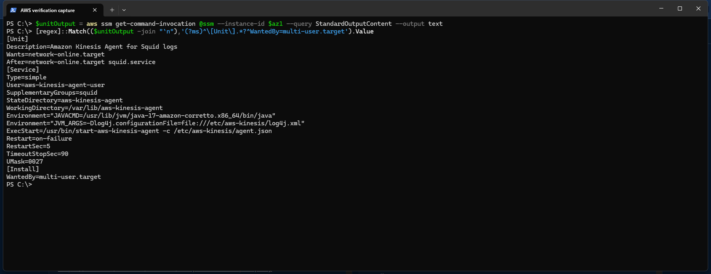
*構築直後のSSM履歴からunitを抽出した画面です。実行ユーザー、グループ、Javaの指定を確認できます。*


**実行したコマンド（Windows / PowerShell）**

```powershell
aws ssm get-command-invocation @ssm --instance-id $az1 --query StandardOutputContent --output text | Select-Object -Last 10
aws ssm get-command-invocation @ssm --instance-id $az2 --query StandardOutputContent --output text | Select-Object -Last 10
```


*構築直後の履歴の末尾10行です。両EC2のログ権限とチェックポイントの所有者を確認できます。*
:::

### AgentとFirehoseの設定

Agentの要点は、監視ファイル、1レコードにまとめるサイズ、送信バッファです。以下は5,120 Bで集約する設定例で、比較テストは`0`から始めました。

```json:agent.json（抜粋）
{
  "cloudwatch.emitMetrics": false,
  "checkpointFile": "/var/lib/aws-kinesis-agent/checkpoints",
  "firehose.endpoint": "https://firehose.ap-southeast-2.amazonaws.com",
  "flows": [{
    "filePattern": "/var/log/squid/access.log*",
    "deliveryStream": "YOUR_STREAM_NAME",
    "initialPosition": "START_OF_FILE",
    "aggregatedRecordSizeBytes": 5120,
    "maxBufferAgeMillis": 60000,
    "maxBufferSizeBytes": 4194304,
    "maxBufferSizeRecords": 500,
    "minTimeBetweenFilePollsMillis": 100
  }]
}
```

`initialPosition`はチェックポイントがないファイルの読み始めを指定します。既存のチェックポイントは保持します。CloudWatch独自メトリクスは無効にし、比較にはFirehose標準メトリクスを使いました。

FirehoseのS3配信バッファは**60秒・5MiB**です。圧縮や区切り文字の追加は無効にし、Squidログの改行をそのまま保存します。

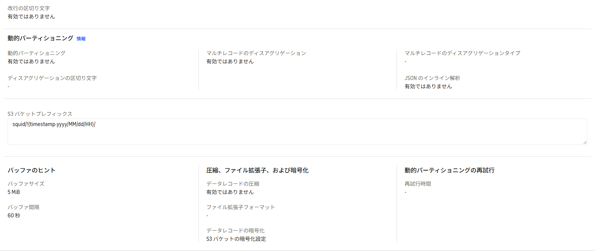
*FirehoseのS3配信設定。60秒・5MiB、圧縮なし、区切り文字追加・動的パーティショニング無効を確認します。*

:::details Firehose APIとS3の保存設定
**実行したコマンド（Windows / PowerShell）**

```powershell
aws firehose describe-delivery-stream @awsA --delivery-stream-name $stream --query 'DeliveryStreamDescription.{Input:DeliveryStreamType,State:DeliveryStreamStatus,S3:Destinations[].ExtendedS3DestinationDescription.{Prefix:Prefix,Buffer:BufferingHints,Compression:CompressionFormat}}' --output json
```

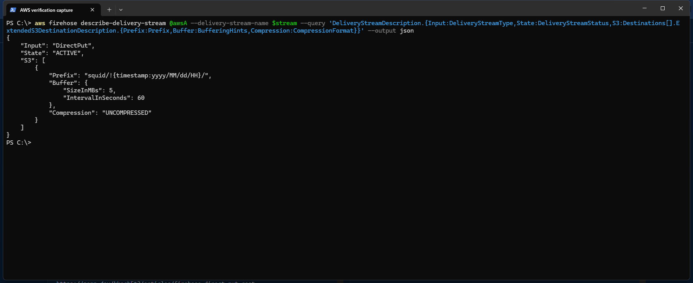
*削除前にAWS APIで取得した設定です。DirectPut・60秒・5MiB・UNCOMPRESSEDを確認できます。*


**実行したコマンド（Windows / PowerShell）**

```powershell
aws s3api get-public-access-block @awsA --bucket $bucket --output json
aws s3api get-bucket-encryption @awsA --bucket $bucket --query 'ServerSideEncryptionConfiguration.Rules[].ApplyServerSideEncryptionByDefault' --output json
aws s3api get-bucket-versioning @awsA --bucket $bucket --output json
```

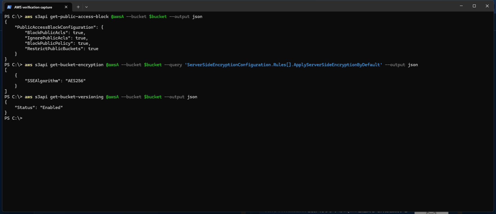
*公開アクセスのブロック4項目がtrue、デフォルト暗号化がAES256、バージョニングがEnabledです。*
:::

## 通信してS3への到着を確認する

### 両方のEC2を通ることを確認する

NLBの両ターゲットが`healthy`、B側Endpointが`available`になった後、AZ別DNS名を使って各Squidを通します。

```powershell
# 各AZのSquidを通して3アクセスずつ発生させる
python logging/labctl.py generate --route az1 --count 3 --run smoke-az1
python logging/labctl.py generate --route az2 --count 3 --run smoke-az2
```

初回は計6アクセスすべてHTTP 200で、EC2とS3のログも6行・1,137 Bで一致しました。管理スクリプトはLambdaの実行を指示するもので、ログをFirehoseへ送るのはKinesis Agentです。

:::details 実行したコマンド
```powershell
$proof='C:\PATH\TO\SAVED_EVIDENCE'
```

**実行したコマンド（Windows / PowerShell）**

```powershell
(Get-Content "$proof\readiness.json" -Raw | ConvertFrom-Json).targets.TargetHealthDescriptions | Select-Object @{n='EC2';e={if($_.Target.Id -eq $az1){'AZ1'}else{'AZ2'}}},@{n='Port';e={$_.Target.Port}},@{n='State';e={$_.TargetHealth.State}} | Format-Table
(Get-Content "$proof\readiness.json" -Raw | ConvertFrom-Json).endpoint.VpcEndpoints | Select-Object State,VpcEndpointType | Format-Table
(Get-Content "$proof\az1-response.json" -Raw | ConvertFrom-Json).requests | Select-Object request_id,status | Format-Table
(Get-Content "$proof\az2-response.json" -Raw | ConvertFrom-Json).requests | Select-Object request_id,status | Format-Table
```
:::

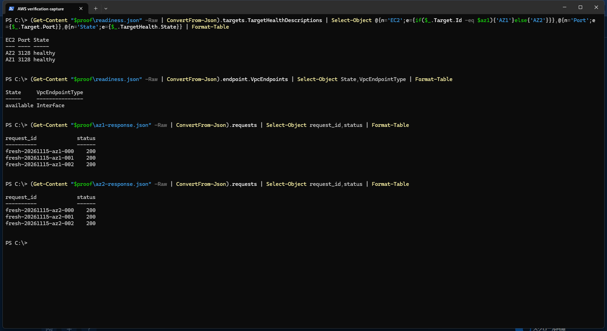
*検証時に保存したNLB・Endpointの状態とLambda応答を読み出した画面です。各AZで3回ずつHTTP 200になっています。撮影時の再テストではありません。*

### どのEC2の、どのアクセスのログかを照合する

2台分のログが同じS3へ届くため、Squidログに次の識別情報を追加しました。

| 項目 | 意味 |
|---|---|
| `source=az1` / `source=az2` | ログを出したSquid EC2。接続元クライアントではない |
| `instance=...` | そのSquid EC2のインスタンスID |
| `request=...` | Lambdaがテストアクセスごとに付けた識別番号 |

たとえば`fresh-20261115-az1-000`がLambda応答とS3ログに残れば、AZ1を通したそのアクセスのログが届いたと分かります。HTTPSのパスはSquidから読めないため、CONNECT時の`X-Lab-Request`ヘッダーを照合用に記録しています。

:::details 実行したコマンド
```powershell
$s3Uri='s3://YOUR_BUCKET_NAME/YOUR_OBJECT_KEY'
```

**実行したコマンド（Windows / PowerShell）**

```powershell
aws s3api list-objects-v2 @awsA --bucket $bucket --prefix squid/ --query 'Contents[:3].{Key:Key,Size:Size}' --output table
aws s3 cp $s3Uri - --profile medallion-lab --region ap-southeast-2 --no-cli-pager | Select-String -Pattern 'request=fresh-20261115-az[12]-000$' | ForEach-Object { $_.Line -replace '\b(?:\d{1,3}\.){3}\d{1,3}\b','[IP]' -replace 'i-[0-9a-f]{17}','[EC2-ID]' }
```
:::

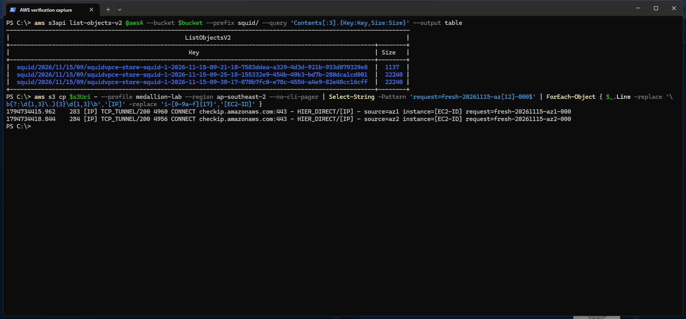
*AWS CLIでS3から取得したオブジェクト一覧と実ログです。Lambda応答と同じrequestを確認できます。IPとEC2 IDは表示時にマスクしています。*

### PrivateLink経由の送信と原本の一致を確認する

両EC2でFirehoseの名前解決先がEndpoint ENIのプライベートIPと一致しました。EC2ロールの送信ポリシー単体も評価し、`aws:SourceVpce`条件ありは`allowed`、条件なしは`implicitDeny`でした。

:::details Endpoint ENIと名前解決結果の証跡
```powershell
$eniIds=@('YOUR_ENDPOINT_ENI_1_ID','YOUR_ENDPOINT_ENI_2_ID')
$dnsId='YOUR_DNS_CHECK_SSM_COMMAND_ID'
```

**実行したコマンド（Windows / PowerShell）**

```powershell
aws ec2 describe-vpc-endpoints @awsA --vpc-endpoint-ids $endpointId --query 'VpcEndpoints[].{State:State,PrivateDnsEnabled:PrivateDnsEnabled}' --output table
aws ec2 describe-network-interfaces @awsA --network-interface-ids $eniIds --query 'NetworkInterfaces[].{AZ:AvailabilityZone,IP:PrivateIpAddress}' --output table
aws ssm get-command-invocation @awsA --command-id $dnsId --instance-id $az1 --query StandardOutputContent --output text | Select-Object -First 1
aws ssm get-command-invocation @awsA --command-id $dnsId --instance-id $az2 --query StandardOutputContent --output text | Select-Object -First 1
```

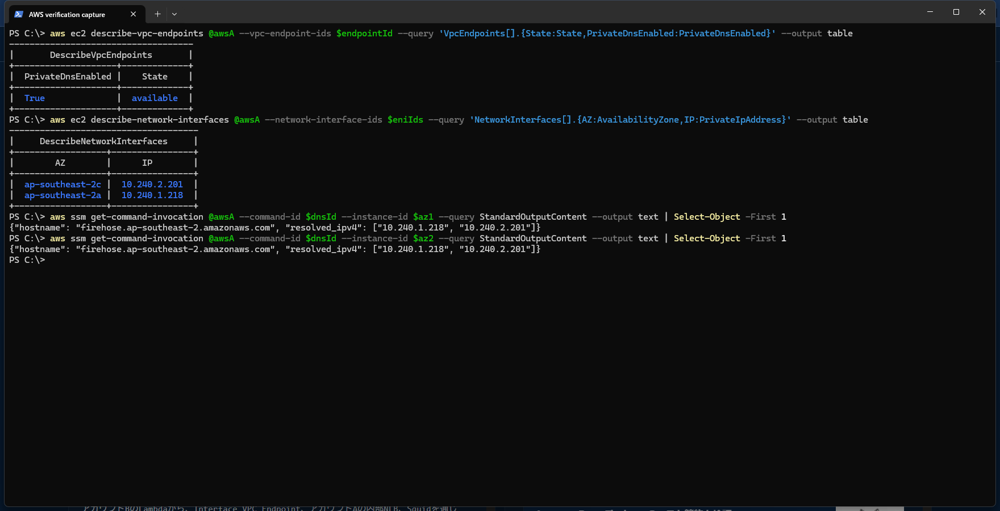
*上段は撮影時に取得したEndpoint・ENIの情報、下段はSSMに残る検証時の名前解決結果です。2台ともEndpoint ENIのIPと一致しています。*
:::

最終照合では、EC2の現行・ローテーション済みログと、S3のログオブジェクト10個を保存し、行の内容・出現回数・改行を比較しました。

| 確認項目 | 結果 |
|---|---:|
| EC2原本 / S3原本 | ともに786行・146,012 B |
| 欠損 / 余分な行 | 0行 / 0行 |
| 成功したアクセスのID | 786件すべて1回ずつ到着 |
| 送信元 / 改行 | 各AZ 393行 / 全行LFを保持 |

複数EC2のログが同じストリームへ入るため、全体の並び順ではなく、行の内容と回数で判定しています。

## Kinesis Agentの集約効果を比較する

### 通常の追記と蓄積後では結果が変わる

各条件は2台へ60アクセスずつ、計120アクセスです。ポーリング間隔は100ms、送信バッファの時間上限は60秒にそろえました。「蓄積後」はAgentを正常停止してログをため、起動後に読ませる条件です。

| 読み込み条件 | 集約サイズ | IncomingRecords | IncomingBytes |
|---|---:|---:|---:|
| 通常の追記 | 0 B | 120 | 22,240 B |
| 通常の追記 | 5,120 B | 120 | 22,240 B |
| 通常の追記 | 51,200 B | 120 | 22,240 B |
| 蓄積後に開始 | 0 B | 120 | 22,180 B |
| 蓄積後に開始 | 5,120 B | 6 | 22,240 B |
| 蓄積後に開始 | 51,200 B | 2 | 22,300 B |

**通常の追記では、集約サイズを大きくしても120レコードのままでした。** `aggregatedRecordSizeBytes`は、指定サイズまで後続の行を待つタイマーではありません。今回の追記間隔では、読み込む範囲に1行ずつ現れたためです。

`maxBufferAgeMillis`は作成済みレコードの送信待機時間で、後から来た行を再集約する設定ではありません。一方、蓄積したログを一度に読む条件では、6レコード・2レコードまで減りました。

6条件すべてで、CloudWatchのSumとAgentの送信成功記録のレコード数・バイト数が一致し、バイト数はEC2原本とも一致しました。前条件の送信完了を待って計測区間を分けました。

:::details 実行したコマンド
**実行したコマンド（Windows / PowerShell）**

```powershell
$cw=@('--profile','medallion-lab','--region','ap-southeast-2','--namespace','AWS/Firehose','--dimensions','Name=DeliveryStreamName,Value=squidvpce-store-squid','--start-time','2026-11-15T09:49:00Z','--end-time','2026-11-15T09:53:00Z','--period','60','--statistics','Sum','--no-cli-pager')
aws cloudwatch get-metric-statistics @cw --metric-name IncomingRecords --query Datapoints --output json
aws cloudwatch get-metric-statistics @cw --metric-name IncomingBytes --query Datapoints --output json
```
:::


*蓄積後・51,200 B設定の検証区間を後から取得した実画面です。IncomingRecordsのSumは2、IncomingBytesは22,300 Bでした。*

### 料金は入力レコードごとに切り上げる

Direct PUTの課金対象量は、**入力レコードごとに5,120 B単位へ切り上げて合計**します。S3ファイルの数や、`IncomingBytes`の総量を一度だけ切り上げる計算ではありません。

| 条件 | レコード数 | 計算上の課金対象量 | 集約なし比 |
|---|---:|---:|---:|
| 通常の追記：3設定とも | 120 | 614,400 B | 削減なし |
| 蓄積後：集約なし | 120 | 614,400 B | 基準 |
| 蓄積後：5,120 B | 6 | 30,720 B | 95.0%削減 |
| 蓄積後：51,200 B | 2 | 30,720 B | 95.0%削減 |

51,200 B設定の実レコードは11,150 Bが2個でした。各々を15,360 Bへ切り上げるため、合計は30,720 Bです。レコード数はさらに減っても、課金対象量は5,120 B設定と同じでした。

これは実測から計算した量で、Cost Explorerの実請求額ではありません。**蓄積後の95%削減を、通常のリアルタイム収集にも当てはめることはできません。**

## ローテーション・再起動・送信失敗を確認する

| テスト | 行った操作 | S3への到着 |
|---|---|---:|
| ローテーション | rename、新規ファイル作成、Squidの再オープン | 20件すべて1回ずつ |
| 正常再起動 | チェックポイントを保持してAgentを再起動 | 20件すべて1回ずつ |
| 送信失敗からの復旧 | 送信先を一時的に到達不能にし、元へ戻す | 20件すべて1回ずつ |

ローテーションは`copytruncate`を使わず、旧ログを非圧縮で残しました。Agentは`access.log*`を監視し、新しいログも`0640 squid:squid`で読めるようにしています。

送信失敗は送信先を`https://127.0.0.1:9`へ切り替えて模擬し、両EC2で`Connection refused`と`Will retry`を確認しました。復旧時もチェックポイントは削除していません。

:::details 運用テストの操作と実画面
EC2内で行った主な操作です。

```bash
# ローテーションとファイルの確認
sudo logrotate -f /etc/logrotate.d/squid
sudo ls -li /var/log/squid/access.log*
# チェックポイントを保持して正常再起動する
sudo systemctl restart aws-kinesis-agent
sudo systemctl status aws-kinesis-agent --no-pager
# 送信失敗時のログを確認する
sudo grep -E 'Connection refused|Retriable send error' /var/log/aws-kinesis-agent/aws-kinesis-agent.log | tail -n 1
```

以下は、その検証時のSSM履歴をWindowsから読み出した画面です。

```powershell
$rotateId='YOUR_ROTATION_SSM_COMMAND_ID'
```

**実行したコマンド（Windows / PowerShell）**

```powershell
aws ssm get-command-invocation @awsA --command-id $rotateId --instance-id $az1 --query StandardOutputContent --output text
aws ssm get-command-invocation @awsA --command-id $rotateId --instance-id $az2 --query StandardOutputContent --output text
```

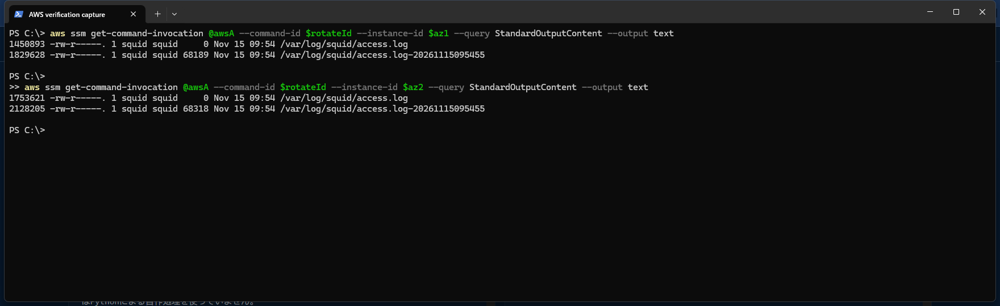
*新旧ログのinodeが異なり、両EC2でsquid:squid・0640になっている記録です。*

```powershell
$restartId='YOUR_RESTART_SSM_COMMAND_ID'
```

**実行したコマンド（Windows / PowerShell）**

```powershell
aws ssm get-command-invocation @awsA --command-id $restartId --instance-id $az1 --query "[Status,ExecutionStartDateTime,StandardOutputContent]" --output text
aws ssm get-command-invocation @awsA --command-id $restartId --instance-id $az2 --query "[Status,ExecutionStartDateTime,StandardOutputContent]" --output text
```

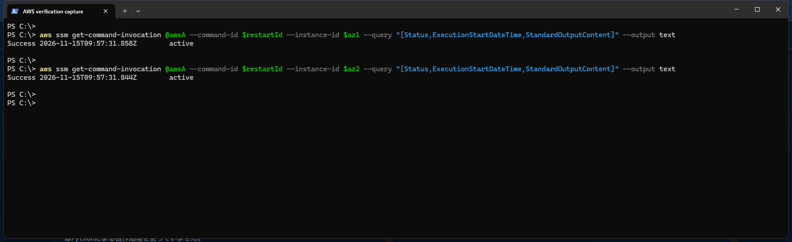
*検証時の再起動コマンドのSuccess・実行日時・activeを取得した画面です。撮影時に再起動したものではありません。*

```powershell
$failureId='YOUR_FAILURE_OBSERVATION_SSM_COMMAND_ID'
```

**実行したコマンド（Windows / PowerShell）**

```powershell
aws ssm get-command-invocation @awsA --command-id $failureId --instance-id $az1 --query StandardOutputContent --output text | Select-Object -First 1
aws ssm get-command-invocation @awsA --command-id $failureId --instance-id $az2 --query StandardOutputContent --output text | Select-Object -First 1
```


*検証時のConnection refusedとWill retryを、各EC2の履歴から抜粋しています。撮影時に障害を再発生させたものではありません。*
:::

確認したのは上記の条件です。異常終了や応答喪失を含むすべての状況で重複が起きないとは限らず、必要に応じて下流でリクエストIDなどによる重複排除を設計します。

## 検証環境の費用と片付け

### 固定部分と従量料金を分ける

2026年11月16日に料金APIで取得したシドニーの単価を使うと、検証環境1組の固定部分は**約$0.116/時・約$2.78/日**です。無料枠・割引・税は含みません。

| 固定部分 | 単価・数量 | 1時間あたり |
|---|---|---:|
| EC2 | t3.micro $0.0132 × 2台 | $0.0264 |
| NLB | $0.0252 × 1台 | $0.0252 |
| プロキシ用Endpoint | $0.013 × 2AZ | $0.0260 |
| Firehose用Endpoint | $0.013 × 2AZ | $0.0260 |
| 公開IPv4 | $0.005 × 2個 | $0.0100 |
| EBS | gp3 $0.096/GB月 × 16GB ÷ 730時間 | 約$0.0021 |
| 合計 | EBSは1か月730時間で換算 | 約$0.1157 |

これにFirehoseの取り込み、Endpointのデータ処理、NLBのNLCU、S3保存・PUTなどが加わります。

:::details 実行したコマンド
```powershell
$priceArgs=@('--profile','medallion-lab','--region','us-east-1','--no-cli-pager')
```

**実行したコマンド（Windows / PowerShell）**

```powershell
$products=aws pricing get-products @priceArgs --service-code AmazonVPC --filters 'Type=TERM_MATCH,Field=location,Value=Asia Pacific (Sydney)' 'Type=TERM_MATCH,Field=group,Value=VPCE:VpcEndpoint' --query PriceList --output json | ConvertFrom-Json
$products | ForEach-Object { $p=$_ | ConvertFrom-Json; $p.terms.OnDemand.PSObject.Properties.Value.priceDimensions.PSObject.Properties.Value | Select-Object @{n='Usage';e={$p.product.attributes.usagetype}},unit,@{n='USD';e={$_.pricePerUnit.USD}},beginRange,endRange } | Format-Table -AutoSize
```
:::

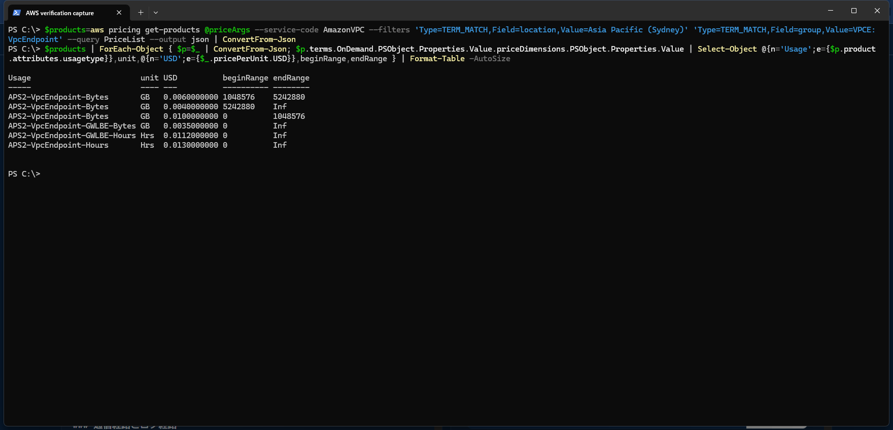
*AWS料金APIで取得した単価です。VpcEndpoint-Hoursは1AZあたり$0.013/時。Bytesは処理量の料金段階です。GWLBEの行は今回のInterface Endpointには使いません。実請求額の画面ではありません。*

料金APIの取得先は`us-east-1`ですが、検索条件はシドニーです。Endpointの処理量は最初の1PB/月まで$0.01/GBで、その後は段階単価が適用されます。

### EC2の停止だけでは料金が残る

Endpoint・NLB・EBSは、EC2を止めても料金が発生します。Firehose用Endpointの2AZ分だけでも、$0.026 × 24時間＝$0.624/日です。

今回の検証リソースは、原本・設定・実画面を保存した後に削除しました。S3の保持バケットと全バージョン、ロググループも含めて残存を確認しています。

**参考資料**

- [AWS：FirehoseとAWS PrivateLink](https://docs.aws.amazon.com/firehose/latest/dev/vpc.html)
- [AWS：Kinesis Agentの設定](https://docs.aws.amazon.com/firehose/latest/dev/agent-config-settings.html)
- [AWS：Amazon Corretto 17とは](https://docs.aws.amazon.com/corretto/latest/corretto-17-ug/what-is-corretto-17.html)
- [AWS：Kinesis Agentの導入](https://docs.aws.amazon.com/firehose/latest/dev/download-install.html)
- [AWS：Firehoseの料金](https://aws.amazon.com/firehose/pricing/)
- [AWS：PrivateLinkの料金](https://aws.amazon.com/privatelink/pricing/)
- [Amazon Kinesis Agentの集約実装](https://github.com/awslabs/amazon-kinesis-agent/blob/aa0d9089ed6b0ce9c10871f403bfcf20b74a461f/src/com/amazon/kinesis/streaming/agent/tailing/AggregationSplitter.java)
