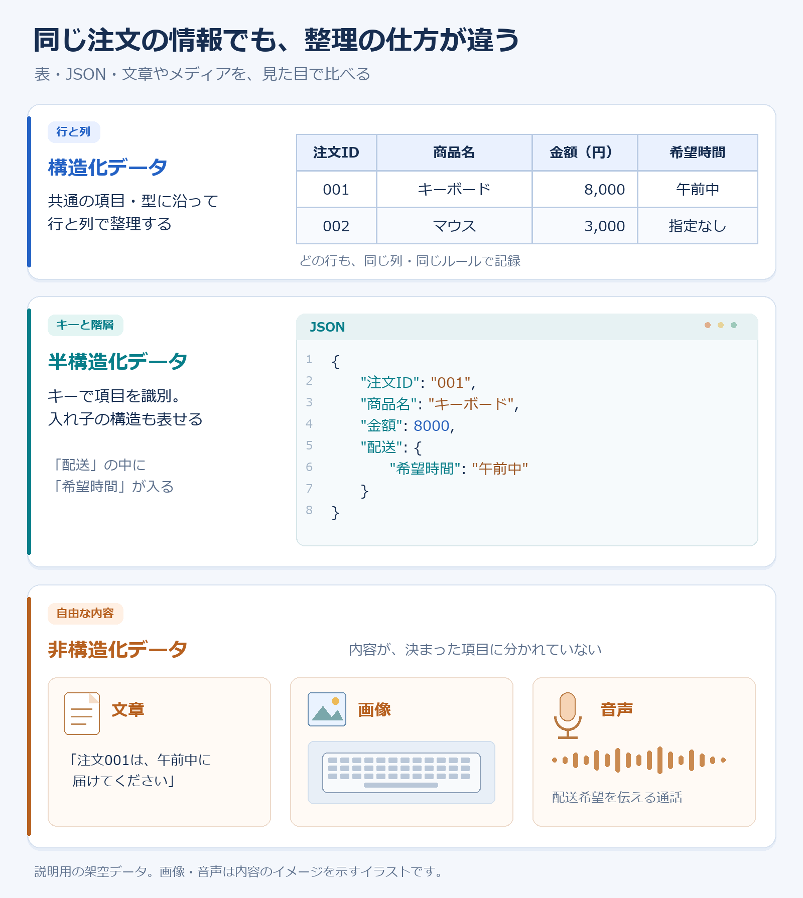
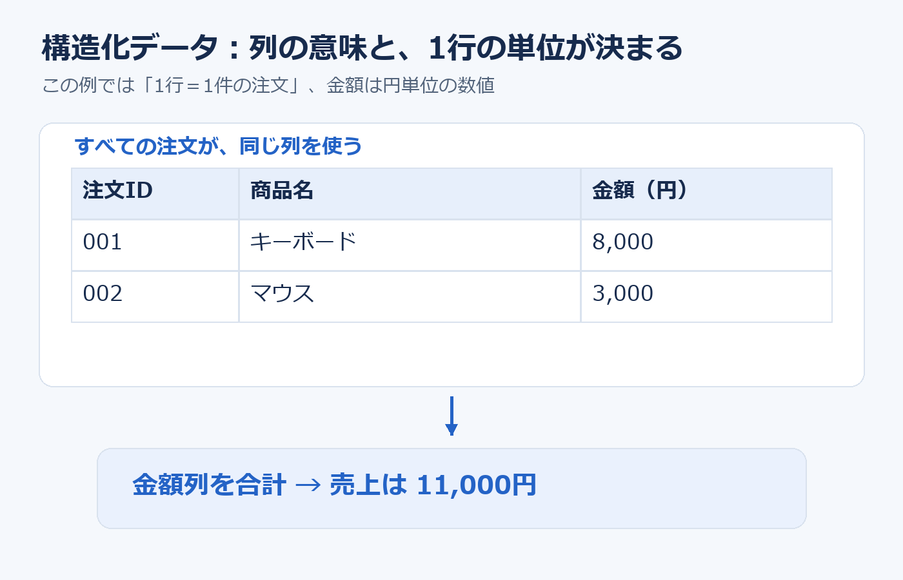
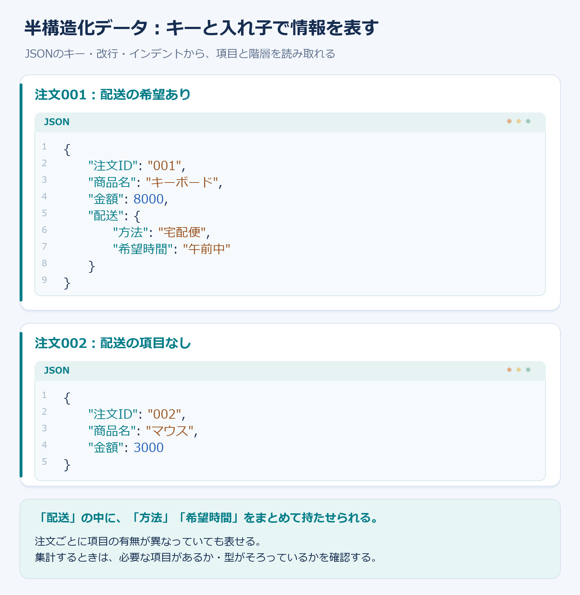
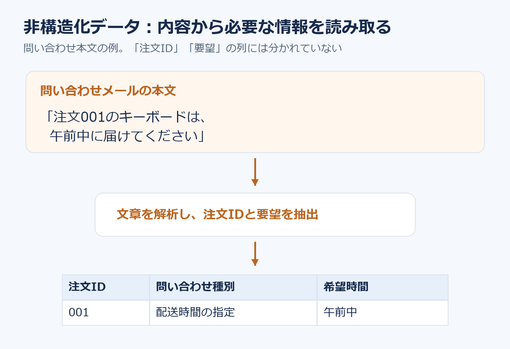
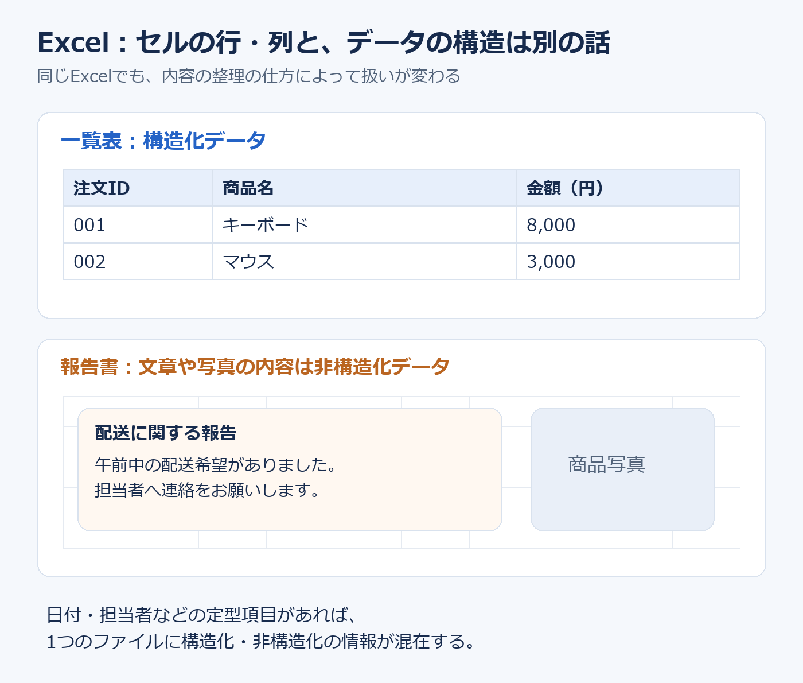
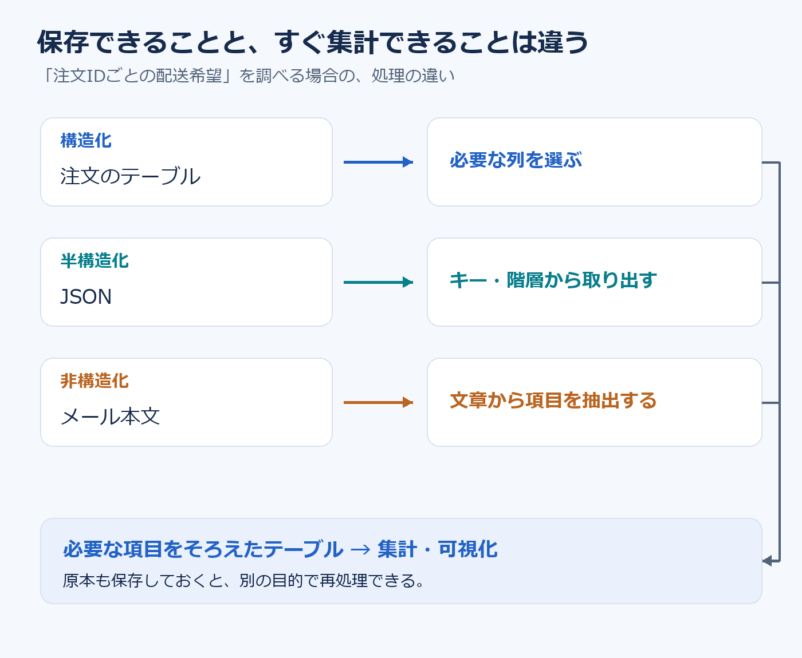

データ基盤について調べていると、「構造化データ」「半構造化データ」「非構造化データ」という言葉が出てきます。

「構造化データは表で、半構造化データはJSON、非構造化データは画像」と覚えると入りやすいものの、それだけでは「Excelなら全部、構造化データなのか？」と迷ってしまいます。

この記事では、**データの項目や形式が、どのようなルールで整理されているか**に注目して、3種類の違いを整理します。同じ注文に関する情報を例に、それぞれの概要・代表例・特徴を見ていきます。

:::message
この記事の図やコードは、架空の注文データを使った説明用の例です。
:::

## 3種類のデータは何が違うのか

### データの「構造」とは？

ここでいう「構造」は、**どこに、何の情報が、どのような形式で入るかという決まり**です。

例えば注文データなら、次のような決まりが考えられます。

- 「注文ID」は注文を識別する文字列
- 「商品名」は購入した商品の名前
- 「金額」は円単位の数値
- 1件の注文を、1行のデータとして扱う

このような項目名・データ型・制約などのルールを、**スキーマ（Schema）** と呼びます。[^schema]

3種類の大まかな違いは、次のとおりです。

| 種類 | 情報の整理の仕方 | 注文に関する例 |
| --- | --- | --- |
| 構造化データ（Structured Data） | 共通の項目や型に沿って整理する | 注文ID・商品名・金額が並ぶ注文テーブル |
| 半構造化データ（Semi-structured Data） | キーやタグ、階層で情報を識別する。項目の組み合わせなどを柔軟に表せる | 配送情報を入れ子にしたJSON |
| 非構造化データ（Unstructured Data） | 内容が、分析用の決まった項目に整理されていない | 問い合わせの文章、商品の写真、通話音声 |

**行・列の表に整理されているかは、有力な目安です。ただし、見た目だけで分類できるわけではありません。**

また、3種類は優劣を表すものではありません。売上を集計するには表が便利ですが、商品の傷を確認するには写真が必要です。残したい情報と、利用目的によって適した形が変わります。

### 同じ注文情報を3種類のデータで比較する

「注文001でキーボードを購入し、午前中の配送を希望する」という場面を考えます。


*同じ注文に関する情報でも、項目への整理の仕方が異なる。各例は特徴が分かる部分を抜粋。*

- **構造化データ**では、「注文ID」「商品名」「金額」「希望時間」などの列を用意し、共通のルールで記録します。
- **半構造化データ**では、JSONのキーで情報を表し、「配送」の中に「希望時間」を入れる、といった階層を作れます。
- **非構造化データ**では、「午前中に届けてください」という文章を、そのまま残します。

文章にも同じ情報は含まれています。ただ、プログラムが「希望時間」だけを取り出すときの処理が変わります。この違いを踏まえて、それぞれを詳しく見ていきます。

## 構造化データとは

### どういうデータ？

**あらかじめ決めた項目や形式に沿って、整理されたデータ**です。代表的な形は、行と列からなるテーブルです。

注文テーブルなら、1行が1件の注文を表し、各列には同じ種類の情報が入ります。


*「金額」の列が決まっているため、どの値を合計するかが明確になる。*

この例では、「金額は円単位の数値」というルールがあるため、8,000円と3,000円を足して、11,000円と集計できます。

リレーショナルデータベースでは、列のデータ型や、注文IDの重複を認めないといった制約を設定できます。こうしたルールによって、記録の形式をそろえやすくなります。

:::message
**値が空欄でも、直ちに半構造化データになるわけではありません。**
例えば、共通の「希望時間」列を用意し、指定がない注文ではNULLにするテーブルも、構造化データです。項目が定義されていることと、すべての項目に値が入っていることは別です。
:::

### 代表例

| 代表例 | 項目の例 |
| --- | --- |
| 業務データベースの注文テーブル | 注文ID、顧客ID、注文日時、金額 |
| Excelで管理する売上一覧 | 売上日、商品コード、数量、売上金額 |
| 定型のCSVファイル | 社員番号、所属部署、入社日 |
| 在庫管理のデータ | 商品コード、倉庫コード、在庫数 |

例えば、次のCSVは、全レコードが同じ項目に従っています。

```csv:orders.csv
order_id,product_name,amount
001,キーボード,8000
002,マウス,3000
```

CSV自体には、金額が数値であることや、注文IDが一意であることを強制する機能はありません。それでも、項目の意味と形式を決めて運用すれば、構造化データとして扱えます。

### 特徴

| 特徴 | 説明 |
| --- | --- |
| ⭕集計しやすい | 売上合計・件数・平均などを、決まった列に対して計算できる |
| ⭕照合しやすい | 注文IDや顧客IDを使って、複数のテーブルを結び付けられる |
| ⭕品質を確認しやすい | 型・必須項目・重複など、チェックするルールを定めやすい |
| ❌項目変更に調整が必要 | 新しい列を追加すると、取り込み処理や既存の帳票にも影響する場合がある |
| ❌自由な内容を項目だけでは表しにくい | 商品写真や長い問い合わせの文脈を、定型項目だけで十分に表すのは難しい |

例えば、配送の要望を「午前中」「午後」「指定なし」の3択にすると集計は簡単です。一方で、「玄関ではなく裏口に置いてほしい」といった要望を残すには、別の項目や自由記述欄も必要になります。

## 半構造化データとは

### どういうデータ？

**キーやタグなどの構造はあるものの、固定した行・列の表に収めることを前提としないデータ**です。JSONやXMLが代表例です。

例えばJSONでは、`"注文ID": "001"`のように、情報の名前を示す**キー**と、その**値**を組み合わせます。値の中に、さらにキーと値の組み合わせを持たせる「入れ子」も使えます。


*注文001には配送の項目があり、注文002にはない。各データの構造はキーから読み取れる。*

```json:orders.json
[
  {
    "注文ID": "001",
    "商品名": "キーボード",
    "金額": 8000,
    "配送": {
      "方法": "宅配便",
      "希望時間": "午前中"
    }
  },
  {
    "注文ID": "002",
    "商品名": "マウス",
    "金額": 3000
  }
]
```

この例では、注文001だけに「配送」があり、その中に「方法」と「希望時間」が入っています。共通の列を増やすことなく、関連する情報をまとめて表現できます。

:::message
**「半構造化」は、ルールがないという意味ではありません。**
JSONには構文のルールがあり、さらにJSON Schemaなどで必須項目や型を厳密に指定することもできます。JSONは半構造化データの代表例ですが、実際のデータをどこまで厳密にそろえるかは設計次第です。

また、JSONをデータベースの1つの列に保存しても、その中身を半構造化データとして扱うことはできます。「行・列で管理されていないこと」だけが分類条件ではありません。[^semi]
:::

### 代表例

| 代表例 | 使われる場面 |
| --- | --- |
| JSON | Web APIの応答、アプリケーションのイベント情報 |
| XML | システム間のデータ交換、設定情報 |
| JSON形式のログ | 時刻や処理名に加え、イベントごとに異なる詳細情報を記録する |
| ドキュメント型データベースのデータ | 商品ごとに異なる属性を、キーと値や配列で保持する |

例えば、商品の情報なら「キーボードにはキー配列」「ディスプレイには画面サイズ」と、種類によって異なる項目を持たせられます。

なお、**ログはすべて半構造化データというわけではありません**。固定の列で記録したログ、JSONのログ、自由文中心のログでは、それぞれ扱いが変わります。

### 特徴

| 特徴 | 説明 |
| --- | --- |
| ⭕項目を柔軟に持たせられる | イベントや商品ごとに異なる属性を記録しやすい |
| ⭕階層を表現しやすい | 配送情報や複数の注文明細など、関連する情報をまとめられる |
| ⭕機械で項目を識別できる | 自由文と比べ、キーやタグを手掛かりに値を取り出しやすい |
| ❌表記や型がばらつきやすい | `amount`と`price`、数値の`8000`と文字列の`"8000"`などを調整する必要がある |
| ❌集計時の処理が増える場合がある | 入れ子の展開、配列の行への展開、項目欠落への対応などが必要になる |

例えば金額の合計を求める際、単にキーを読むだけではなく、「金額がない場合はどうするか」「文字列で届いた値をどう扱うか」を決めておく必要があります。

柔軟に記録できる分、**集計で使う項目については、名前・型・単位をそろえる設計**が大切です。

## 非構造化データとは

### どういうデータ？

**分析したい内容が、あらかじめ決めた項目に整理されていないデータ**です。自由な文章や、画像・音声・動画などが該当します。

例えば、次の問い合わせ本文には、注文IDと配送の希望が含まれています。

> 注文001のキーボードは、午前中に届けてください。

人が読めば意味は分かります。しかし、そのままでは「注文ID」「問い合わせ種別」「希望時間」という列には分かれていません。これらを集計したい場合には、文章から情報を抽出します。


*文章から必要な項目を取り出すと、その結果を構造化データとして扱える。*

抽出の方法には、ルールによる文字列処理、自然言語処理、生成AIなどがあります。画像であればOCR（光学文字認識）、音声であれば文字起こしなどを組み合わせる場合もあります。どこまでの処理が必要かは、知りたい情報によって変わります。

:::message
**「非構造化」は、ファイルの内部に構造がまったくないという意味ではありません。**
PNG画像には画像形式としての決まりがあり、文章には段落や見出しがあります。ただし、それだけで写真の「傷の位置」や文章の「配送の要望」が、分析用の項目として整理されているわけではありません。[^unstructured]
:::

### 代表例

| 代表例 | 内容から取り出したい情報の例 |
| --- | --- |
| 問い合わせメールの本文 | 質問の種類、注文ID、対応が必要な要望 |
| 契約書や報告書の文章 | 契約期間、条件、報告の要点 |
| 商品や設備の写真 | 傷・異常の有無、対象物の種類 |
| コールセンターの通話音声 | 会話内容、問い合わせ理由 |
| 作業の動画 | 作業手順、異常が起きた場面 |

メールには、送信日時や差出人などの定型項目と、自由な本文が混在します。そのため、メール全体を半構造化データと説明する場合もあります。ここでは、**分析対象がメール本文なのか、ヘッダーなどの項目なのか**を分けて考えています。

### 特徴

| 特徴 | 説明 |
| --- | --- |
| ⭕豊富な情報を残せる | 文章の文脈、商品の見た目、声の調子などを保持できる |
| ⭕事前に項目を決め切らずに記録できる | 後から別の観点で調べたくなった場合にも、原本を再利用できる |
| ❌集計前の処理が必要になる場合がある | 文字起こし、OCR、項目抽出などの処理を組み合わせる必要がある |
| ❌抽出結果の確認が必要 | 誤読や解釈の違いがあり、精度の評価や修正が必要になる |
| ❌保存量・処理量が増える場合がある | 高解像度の画像や長時間の動画では、容量や計算資源を多く使うことがある |

例えば「午前中の配送希望は何件あったか」を数えるだけなら、最初から希望時間の項目を用意した方が扱いやすくなります。一方、自由記述を残しておけば、想定していなかった要望にも後から気付けます。

用途によっては、**原文を残しつつ、抽出した項目も別途保存する**方法が適しています。

## 補足

### Excel・CSV・PDFはどの種類に当たるのか

基本的には、**拡張子だけではなく、中の情報がどのように整理されているか**を見ます。

| 形式 | 中身の例 | 分類・扱い方 |
| --- | --- | --- |
| Excel | 1行1件で、日付・商品名・金額がそろう一覧表 | 構造化データとして扱える |
| Excel | 自由な文章・写真・図を配置した報告書 | 主な内容は非構造化データとして扱う |
| CSV | 共通の列で記録した売上明細 | 構造化データとして扱える |
| CSV | IDと、長い自由記述の問い合わせ本文 | レコードの外枠は構造化されているが、本文の内容は非構造化 |
| PDF | 契約書の文章、商品の写真、スキャンした帳票 | 一般に非構造化データとして扱い、目的に応じて内容を抽出する |


*どちらもセルの行・列はあるが、業務情報が共通の項目に整理されているかが違う。図は説明用の模式図。*

Excelでは、セルが行・列に並んでいることと、業務データが構造化されていることを分けて考えます。セル結合や色分けがあるという理由だけで、直ちに非構造化と決まるわけでもありません。**各項目と1件のデータの範囲を、一貫したルールで読み取れるか**が大切です。

また、PDFの中に表があれば、その表を取り出して構造化データとして利用できます。ただし、見た目が表になっていても、PDF内に扱いやすい行・列のデータとして保持されているとは限りません。スキャン画像だけなら、文字を認識する処理から必要になります。

1つのファイルに複数の種類の情報が含まれることもあります。ファイル全体に1つの分類を無理に当てはめるより、**何を分析するのかに応じて、対象の部分を見る**と判断しやすくなります。

### データの種類によって保存・分析の方法はどう変わるのか

データの種類によって、分析までに必要となる処理が変わります。


*同じ集計を目指していても、列の選択・JSONの項目取り出し・文章からの抽出では処理が異なる。*

例えば、注文ごとの配送希望を調べる場合は、次のようになります。

| 入力データ | 必要となる処理の例 |
| --- | --- |
| 希望時間の列がある注文テーブル | 必要な列を選び、値を集計する |
| 配送情報を持つJSON | キーと階層をたどり、項目の有無や型を確認して取り出す |
| 問い合わせの文章 | 文章から注文IDや希望時間を抽出し、結果を確認する |

保存するタイミングにも、違う考え方があります。

- **保存前に項目をそろえる方法**：共通の形式へ変換してから、テーブルなどに格納する
- **元の形で保存し、利用時に項目を取り出す方法**：JSON・文書・画像などを保存し、用途に応じて後から処理する

前者に関連する考え方を**スキーマオンライト（Schema-on-write）** 、後者に関連する考え方を**スキーマオンリード（Schema-on-read）** と呼びます。実際の基盤では、原本を保存する場所と、集計用のテーブルを用意する場所を分け、両方を組み合わせることもあります。

データ基盤の用語と結び付けると、次のように整理できます。[^lake]

| 仕組み | 主な役割とデータの扱い |
| --- | --- |
| データウェアハウス（DWH） | 集計・分析に使いやすいテーブルを管理する。半構造化データを扱える製品もある |
| データレイク | 構造化・半構造化・非構造化データを、多様な形式で保存する |
| データレイクハウス | データレイクを土台に、テーブル管理や分析の機能を組み合わせる |

例えば、Amazon S3に注文CSV・JSON・問い合わせ文書を原本として保存し、その中から必要な項目を取り出して、分析用テーブルを作る構成が考えられます。データレイクハウスを採用しても、文書や画像の内容が自動的に集計用の列へ変わるわけではありません。

また、非構造化データの利用が、常に表への変換を必要とするわけではありません。文書の全文検索や、文章の意味に基づく検索など、内容を探すための別の方法もあります。

データ基盤の種類や、データレイクハウスの位置付けは、次の記事でも整理しています。

https://zenn.dev/kkoch5t2/articles/41ad155b966681

[^schema]: AWS「[What is Structured Data?](https://aws.amazon.com/what-is/structured-data/)」。スキーマ、構造化データの特徴・代表例について参照。
[^semi]: Snowflake公式ドキュメント「[Introduction to loading semi-structured data](https://docs.snowflake.com/en/user-guide/semistructured-intro)」。階層構造や半構造化データの取り扱いについて参照。
[^unstructured]: Snowflake公式ドキュメント「[Unstructured data types](https://docs.snowflake.com/en/sql-reference/data-types-unstructured)」。3種類の分類と、ファイル形式の内部構造との区別について参照。
[^lake]: AWS「[What is a Data Lake?](https://aws.amazon.com/what-is/data-lake/)」。データレイクとDWHの役割について参照。
